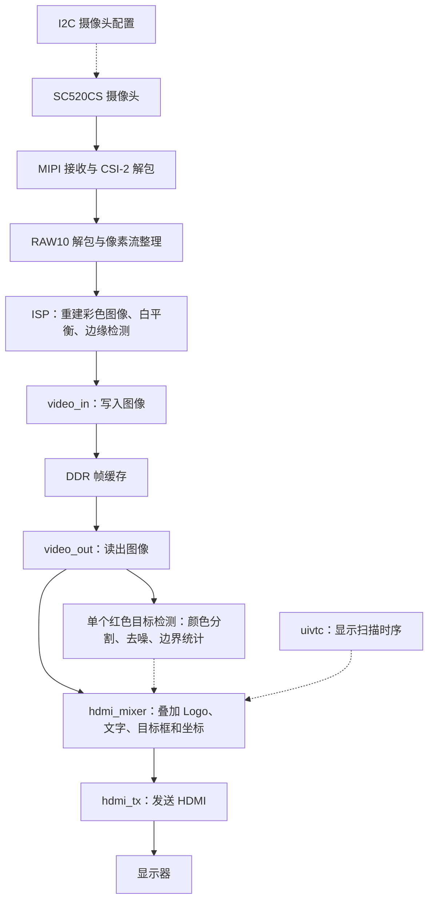

# 代码与配置导航

[返回工程首页](README.md)

这是一个包含摄像头、图像算法、外部存储器和显示接口的完整 FPGA 工程。先理解数据经过哪几个模块，再沿着模块名找对应文件。FPGA 模块通过信号连接并行工作；文件顺序不是软件程序的执行顺序。

本说明依据当前的 [TD 工程文件](td_project/anlogic_edge_osd.al)、[系统顶层](user_source/hdl_source/design_top_wrapper.v) 和 [ISP 顶层](user_source/hdl_source/isp/isp_top.v) 整理。

## 2026-10-03 新增目标检测：现在主要看这三个文件

| 文件 | 修改/新增的内容 | 阅读入口 |
|---|---|---|
| [color_target_detect.v](user_source/hdl_source/color_target_detect.v) | 新增的单个红色目标检测算法 | `O_pixel_red` 颜色判断 → `line1/line2` 和 `votes` 去噪 → `count/xmin/xmax/ymin/ymax` 每帧统计 |
| [hdmi_mixer.v](user_source/hdl_source/hdmi_mixer.v) | 在原有显示模块接入检测，添加框、中心十字、状态与坐标；修正帧首重复计数 | `u_color_target_detect` → `S_display_frame_start` → `S_target_box_on`/`S_target_cross_on` → 输出选择 |
| [design_top_wrapper.v](user_source/hdl_source/design_top_wrapper.v) | 启用新功能 | `u_hdmi_mixer` 的 `SHOW_COLOR_TARGET(1)`；默认 `SHOW_RED_MASK=0` |

检测在 **DDR 读出之后、屏幕叠加之前**，不是直接替换 ISP 中的边缘模块。
它每拍处理一个显示像素，与画框同属 HDMI 时钟域，不新增跨时钟域坐标总线。
完整一帧统计完成后，下一显示帧使用其结果，因此目标框有一帧延迟。
3×3 多数判决只统计中心在图像内侧的像素，最外一圈不统计。
多个红色区域会得到一个总包围框；当前使用场景是单个红色卡片。

两份 `.al` 已登记新算法源码；`sim/tb_color_target_detect.sv` 和
`sim/tb_color_target_mixer.sv` 只用于仿真，不参与上板综合。
本次未修改摄像头 I²C、曝光/增益、引脚、DDR、现有边缘模块或 K1 切换。
官方边缘模块仍是开发对照，最终提交前需要替换为自己的实现。
操作方法和阈值见 [README.md](README.md)。

## 1. 先认识整条数据通路



- **RAW/Bayer**：摄像头给出的原始感光数据，每个采样位置只对应一种颜色。demosaic 利用周围采样点重建 RGB。
- **ISP**：图像处理流水线的统称。本工程中包含彩色重建、白平衡、边缘检测和数据格式转换。
- **DDR**：存放图像帧，配合读写逻辑连接采集与显示的不同节拍。
- **OSD**：在原画面上叠加文字、数字、Logo。
- **IP**：工具或厂家提供的模块。一个 PLL、FIFO 或 DDR IP 可能需要配置文件、封装和多个下层源码，所以会占很多文件。

## 2. 最先读的五个文件

| 阅读顺序 | 文件 | 它负责什么 | 怎么读 |
|---|---|---|---|
| 1 | [design_top_wrapper.v](user_source/hdl_source/design_top_wrapper.v) | 系统连接、时钟/复位、外设接口和顶层配置 | 先搜 u_isp_top、u_video_in、u_video_out、u_hdmi_mixer，看它们连了哪些信号；再看各实例上面的参数 |
| 2 | [isp_top.v](user_source/hdl_source/isp/isp_top.v) | 串接图像处理模块 | 按 demosaic → data128_96 → awb → rgb_edge_switch_96 → data_96bit_to_128bit 阅读 |
| 3 | [edge_detect_96.v](user_source/hdl_source/isp/edge_detect_96.v) | 把 RGB 图像变成黑白边缘图 | 从 pix0～pix3、gray0～gray3、pair0/pair1，读到 sobel_mag、EDGE_TH 和输出寄存器 |
| 4 | [hdmi_mixer.v](user_source/hdl_source/hdmi_mixer.v) | 叠加文字/Logo、计数以及调试图案 | 先看 LOGO_*、DYN_OSD_*，再看两个字库/Logo 实例以及最后的 DEBUG_MODE 输出选择 |
| 5 | [tb_edge_detect.sv](sim/tb_edge_detect.sv) | 给边缘模块送测试图像，并与参考计算结果比较 | 先看 WIDTH、HEIGHT、THRESHOLD 和 DUT 实例，再看图像输入与检查过程 |

顶层文件中的 `isp_top u_isp_top (...)` 表示：模块类型是 isp_top，本次使用它的实例名是 u_isp_top。想看实现，就去找 `module isp_top`；同一个模块可以被实例化多次。

## 3. ISP 里面各文件的作用

| 阶段 | 当前使用的文件 | 输入与输出、作用 |
|---|---|---|
| 图像处理入口 | [isp_top.v](user_source/hdl_source/isp/isp_top.v) | 输入为 40 位 RAW 数据流，输出为供缓存使用的 128 位数据流 |
| 彩色重建 | [demosaic.v](user_source/hdl_source/isp/demosaic_4x_2_0/demosaic.v) | 处理 Bayer 原始采样；实例化窗口缓存和双线性插值 |
| 构造图像窗口 | [raw_matrix_3x3_buffer.v](user_source/hdl_source/isp/demosaic_4x_2_0/raw_matrix_3x3_buffer.v)、[line_buffer_demosaic.v](user_source/hdl_source/isp/demosaic_4x_2_0/line_buffer_demosaic.v) | 保留相邻行的数据，形成算法所需的邻域 |
| 插值计算 | [bilinear_interpolation.v](user_source/hdl_source/isp/demosaic_4x_2_0/bilinear_interpolation.v) | 根据 Bayer 排列和邻域数据计算彩色像素 |
| 像素格式转换 | [data128_96.v](user_source/hdl_source/isp/data128_96/data128_96.v) | 从四个 32 位位置取出 RGB888，并按代码规定的顺序拼成 96 位 |
| 自动白平衡 | [awb.v](user_source/hdl_source/awb.v) | 统计和调整颜色通道，处理四个 RGB888 像素组成的 96 位数据 |
| 边缘检测 | [edge_detect_96.v](user_source/hdl_source/isp/edge_detect_96.v) | 96 位 RGB 输入，输出同宽黑白边缘图 |
| 模式切换 | [rgb_edge_switch_96.v](user_source/hdl_source/isp/rgb_edge_switch_96.v) | 内含持续运行的边缘模块；将彩色数据延迟一拍，在帧首选择输出 |
| 板载 K1 控制 | [video_mode_control.v](user_source/hdl_source/video_mode_control.v) | 50 MHz 时钟下同步并消抖 20 ms，每次按下翻转一次模式请求 |
| DDR 数据打包 | [data96_128.v](user_source/hdl_source/isp/data96_128/data96_128.v) | 文件内的 data_96bit_to_128bit 模块把 96 位像素流重新打包为 128 位 |

边缘模块当前每拍处理四个像素：先近似灰度化，再将相邻两个像素平均，得到两个采样点；对采样点计算 Sobel 的 `|Gx| + |Gy|`，与阈值比较。每个结果复制为两个输出像素，白色表示边缘，黑色表示非边缘。它不是直接在原始每个像素上执行全分辨率 Sobel。

常见接口信号：`tdata` 是数据，`tvalid` 表示数据有效，`tuser` 在这里表示帧首，`tlast` 表示行尾。`tready` 的实际支持情况需读实现；已有独立边缘仿真固定 ready=1，不能据此认定整条流水线支持任意反压。

## 4. 想改什么，就找哪个配置

下表是当前源码配置，不代表已通过真实硬件验证。文中的文件链接打开后，可以搜索“参数或关键词”列定位。

| 想做的修改 | 修改入口 | 参数或关键词 | 当前设置 / 注意事项 |
|---|---|---|---|
| 改边缘阈值 | [isp_top.v](user_source/hdl_source/isp/isp_top.v) | u_rgb_edge_switch、EDGE_TH | 11'd80；由选择模块传给内部 u_edge_detect_96 |
| 改上电默认模式 | [design_top_wrapper.v](user_source/hdl_source/design_top_wrapper.v)、[sc520_capture_top.v](user_source/hdl_source/sc520_capture_top.v) | ENABLE_EDGE | 主工程 0=彩色；如设为 1 则上电边缘；二者均可按 K1 切换 |
| 改边缘算法 | [edge_detect_96.v](user_source/hdl_source/isp/edge_detect_96.v) | gray、pair、sobel_mag、window_valid | 灰度 → 两像素平均 → Sobel → 阈值；改算法后需要同步审查参考模型 |
| 改仿真阈值 | [tb_edge_detect.sv](sim/tb_edge_detect.sv) | THRESHOLD | 80；同时用于测试中的 DUT 和参考计算，不会自动读取 isp_top 的配置 |
| 改无板测试尺寸 | [tb_edge_detect.sv](sim/tb_edge_detect.sv)、[run_xsim.cmd](sim/run_xsim.cmd) | WIDTH、HEIGHT、SIM_PARAMS | 默认 320×180；run_720p.cmd 通过脚本将参数设为 1280×720；边缘模块要求宽度能被 4 整除 |
| 移动 Logo | [hdmi_mixer.v](user_source/hdl_source/hdmi_mixer.v) | LOGO_X、LOGO_Y | (0,0)；位置可先调整。LOGO_W/H=160×160 与 ROM 数据寻址配套，改大小不能仅改两个数字 |
| 改 Logo 图案 | [anlogic_logo_rom.v](user_source/hdl_source/anlogic_logo_rom.v) | O_pixel、I_addr | 保存 Logo 像素/有效标记，需要与 mixer 的地址计算一致 |
| 移动动态文字/计数 | [hdmi_mixer.v](user_source/hdl_source/hdmi_mixer.v) | DYN_OSD_X、DYN_OSD_Y | (375,120)；显示区域还受 DYN_OSD_W/H 和内部布局限制 |
| 改动态文字颜色 | [hdmi_mixer.v](user_source/hdl_source/hdmi_mixer.v) | COLOR_DYN_TEXT | 24'hfff200，按 RRGGBB 写颜色 |
| 改显示内容或字形 | [hdmi_mixer.v](user_source/hdl_source/hdmi_mixer.v)、[osd_char_lib.v](user_source/hdl_source/osd_char_lib.v) | S_pf_char、CHAR_*、I_char | mixer 选择显示的字符，字库存放图案；不是改一段普通字符串就能显示任意文字 |
| 切换彩条/状态图 | [design_top_wrapper.v](user_source/hdl_source/design_top_wrapper.v) | u_hdmi_mixer、DEBUG_MODE | 0=图像加OSD，1=彩条，2=按状态组合显示颜色，3=分区显示四个状态位；调试模式分支不叠加正常 OSD |
| 调整 Bayer 排列 | [isp_top.v](user_source/hdl_source/isp/isp_top.v) | u_demosaic、BAYER_MODE | BGGR；需匹配传感器实际排列及读出方向 |
| 查看摄像头初始化 | [uicfgcs520.v](user_source/hdl_source/uics520_cfg/uicfgcs520.v)、[uics520reg_720p60.v](user_source/hdl_source/uics520_cfg/uics520reg_720p60.v) | CLK_DIV、REG_DATA | 当前使用 SC520CS 1280×720@60 寄存器表；顶层 CLK_DIV=237，配置时钟约 23.809524 MHz，I²C 约 100 kHz |
| 查看摄像头 MIPI 配置 | [design_top_wrapper.v](user_source/hdl_source/design_top_wrapper.v) | u_mipi_dphy_rx_ph1p_mipiio_wrapper、LANE_NUM | 2 lane；需与摄像头寄存器配置和物理接线一致 |
| 查看显示时序 | [design_top_wrapper.v](user_source/hdl_source/design_top_wrapper.v) | u_hdmi_vtc | 有效尺寸 1280×720；行/帧总长 1650/750；水平同步 1390～1430，垂直同步 725～730 |
| 修改时钟 | [PLL IP](user_source/ip_source/PLL/)、[DDR IP](user_source/hdl_source/ph1p35_ddr/ddr2/) | TD 的 IP 配置与相应约束 | 存在多个时钟域，DDR 也有自身时钟逻辑；应通过对应 IP 配置生成并重新检查时序 |
| 修改板卡引脚 | [pin.adc](user_source/constraints_source/pin.adc) | 各顶层端口的约束 | 对应安路目标板；换 Xilinx 板卡还需要替换平台 IP 和约束，不能只改引脚名 |
| 查看实际顶层时序约束 | [anlogic_edge_osd.sdc](td_project/anlogic_edge_osd.sdc) | create_clock 等时序命令 | 这是 .al 当前登记的顶层 SDC；IP 还有配套约束 |

### 为什么修改了参数却没有效果

Verilog 的模块声明可以写默认参数，但上层实例化时可以覆盖它。例如：

```verilog
// edge_detect_96.v 中的默认值
parameter EDGE_TH = 11'd80

// isp_top.v 中实例化时的配置，会覆盖默认值
rgb_edge_switch_96 #(
    .IMG_WIDTH(1280),
    .IMG_HEIGHT(720),
    .EDGE_TH(11'd80)
) u_rgb_edge_switch (...);
```

所以，要改 TD 系统中的阈值，应改 isp_top.v 的实例参数；要改当前独立仿真的阈值，应改测试台的 THRESHOLD。这两个配置是分别指定的。

同理，hdmi_mixer 模块默认 H_OFFSET/V_OFFSET=128/60，但顶层实例传入的是 0/0；而当前 `O_video_rd_en = I_video_de`，不能仅凭参数名称认定它实现了画面平移。移动当前 Logo/文字，请从上述 LOGO_*、DYN_OSD_* 入手。

### 分辨率不是一个全局开关

当前尺寸在摄像头寄存器表、顶层 uial2axis、ISP 的 demosaic/AWB/edge 实例、HDMI 扫描时序及 mixer 中分别指定。更改尺寸还要检查 PLL 像素时钟、数据打包和 DDR 帧地址/读写长度等逻辑。先用现有 1280×720 系统及 320×180 独立仿真学习；不能只改某一处 IMG_WIDTH/IMG_HEIGHT 就视为完成整机分辨率切换。

## 5. 硬件接口文件何时需要读

| 任务 | 文件或目录 | 作用 |
|---|---|---|
| 摄像头没初始化 | [uics520_cfg/](user_source/hdl_source/uics520_cfg/)、[ae_set.v](user_source/hdl_source/uiisp_beta/ae_set.v) | 芯片 ID、初始化寄存器、I2C 错误、曝光/增益配置请求；通用 I2C 底层仍在 uics500_cfg/uii2c.v |
| MIPI 没收到数据 | [mipi_dphy_rx/](user_source/hdl_source/mipi_dphy_rx/) | 安路 MIPI 物理接收及字节/通道对齐，含加密 IP |
| 收到字节却没有像素帧 | [csi_unpacket_2lane.v](user_source/hdl_source/isp/csi_unpacket_2lane.v)、[raw10_unpacket_2lane.v](user_source/hdl_source/isp/raw10_unpacket_2lane.v)、[uial2axis.v](user_source/hdl_source/isp/uial2axis.v) | CSI-2 包解析、RAW10 像素提取、帧/行有效信号整理 |
| 图像写入/读出缓存异常 | [video_in.v](user_source/hdl_source/video_in.v)、[video_out.v](user_source/hdl_source/video_out.v) | FIFO、帧缓存指针、DDR 读写请求和数据宽度适配 |
| DDR 接口或初始化异常 | [mc_to_user_interface.v](user_source/hdl_source/mc_to_user_interface.v)、[ph1p35_ddr/](user_source/hdl_source/ph1p35_ddr/) | 用户侧请求与存储器控制器接口转换、DDR 控制器/PHY |
| HDMI 扫描位置异常 | [uivtc.v](user_source/hdl_source/vtc/uivtc.v)、[hdmi_mixer.v](user_source/hdl_source/hdmi_mixer.v) | 行同步、场同步、有效显示区域及 OSD 位置 |
| HDMI 输出接口异常 | [hdmi_tx.v](user_source/hdl_source/hdmi_tx.v)、[hdmi_phy_warpper.v](user_source/hdl_source/hdmi_phy_warpper.v)、[lane_lvds_10_1.v](user_source/hdl_source/lane_lvds_10_1.v) | 视频发送及物理串行输出，还依赖加密的 HDMI 内核 |

## 6. 同名文件、IP 配套文件怎么辨认

以下“当前使用”按 .al 文件路径以及顶层实例核对，路径不能只看最后一个文件名。

| 模块 | 当前使用的路径 | 容易误打开的另一份 |
|---|---|---|
| awb | [hdl_source/awb.v](user_source/hdl_source/awb.v) | [hdl_source/isp/awb/awb.v](user_source/hdl_source/isp/awb/awb.v) |
| signal_delay | [hdl_source/signal_delay.v](user_source/hdl_source/signal_delay.v) | [hdl_source/isp/awb/signal_delay.v](user_source/hdl_source/isp/awb/signal_delay.v) |
| data_96bit_to_128bit | [hdl_source/isp/data96_128/data96_128.v](user_source/hdl_source/isp/data96_128/data96_128.v) | [hdl_source/data_96bit_to_128bit.v](user_source/hdl_source/data_96bit_to_128bit.v) |
| csi_unpacket_2lane | [hdl_source/isp/csi_unpacket_2lane.v](user_source/hdl_source/isp/csi_unpacket_2lane.v) | [hdl_source/uiisp_beta/csi_unpacket_2lane.v](user_source/hdl_source/uiisp_beta/csi_unpacket_2lane.v) |
| raw10_unpacket_2lane | [hdl_source/isp/raw10_unpacket_2lane.v](user_source/hdl_source/isp/raw10_unpacket_2lane.v) | [hdl_source/uiisp_beta/raw10_unpacket_2lane.v](user_source/hdl_source/uiisp_beta/raw10_unpacket_2lane.v) |

`image_correction.v` 虽然登记在 .al 中，但带有 `AutoExcluded=true`，当前顶层用直接连线绕过旧裁剪逻辑。看到一个文件在仓库里，甚至在工程登记清单里，也不能认定它一定生成了有效硬件。

| 文件形式 | 通常是什么 | 阅读/修改建议 |
|---|---|---|
| `.v`、`.sv`、`.vh`、`.vhd` | HDL 实现或头文件，也可能是 IP 生成源码 | 根据工程引用和模块层次确定作用 |
| `.enc.v`、`.enc.sv` | 加密 HDL/IP | 从封装端口和配置入手理解 |
| `.xml`、`.ipc`、`.params_*`、`.ports_*` | IP 的配置、参数和端口信息 | 与对应 IP 配套保留；配置变更优先使用 TD 的 IP 工具 |
| IP 目录下的 `RTL/`、`src/`、`DesignConfiguration.xml` | IP 下层实现及配置 | 未逐个列入顶层 .al，也可能由 IP 自动带入 |
| `.mif`、`.dat`、`.mem`、部分 `.txt` | ROM/RAM 初始化数据或配套描述 | 文件多不等于可删，要核对引用 |
| `.al` | TD 工程：器件、顶层、源文件与 IP 清单 | 新模块需要参与综合时，通过 TD 加入并保存 |
| `.adc`、`.sdc`、部分 `.tcl` | 引脚、时序约束或工具脚本 | 从 .al / IP 配置确认实际使用哪一份 |
| `sim/tb_*.sv`、`sim/*.cmd`、`sim/*.do` | 测试台和仿真启动脚本 | 用来验证设计；测试台不要作为 TD 综合源码加入 |

文件不在 .al 的显式清单中，不等于没用：可能是 IP 的下层依赖、include 文件、初始化数据或仿真辅助文件。当前导航不据此删除任何文件。

## 7. 无板子时，第一次学习这样做

1. 打开 [tb_edge_detect.sv](sim/tb_edge_detect.sv)，找到 `THRESHOLD = 80`，观察它如何传给 DUT；再打开 [edge_detect_96.v](user_source/hdl_source/isp/edge_detect_96.v)，找到 `mag0 >= EDGE_TH`。
2. 按 [仿真说明](sim/README.md) 运行 run_xsim.cmd，确认输出 PASS；查看本地生成的输入图片与边缘图片。
3. 可以把测试台 THRESHOLD 改为 160 后重新仿真。对于同一输入，更高阈值通常会留下更少边缘；测试台会按自己的参考计算检查输出。满意后再决定是否把 TD 系统的实例阈值也改为相同值。
4. 理解边缘模块后，再研究 mixer 的 Logo/文字坐标。现有测试台没有验证 OSD，修改它需要补 OSD 仿真或上板观察。

当前边缘算法阈值保持原设置。独立边缘模块历史仿真见 [validation.txt](sim/validation.txt)；2026-10-02 已适配 SC520CS，并增加可旁路边缘模块的彩色工程，详情见 [SC520CS_TEST.md](SC520CS_TEST.md)。摄像头控制总线仿真已通过，整条视频通路尚未上板验证。

## 8. TD 显式登记的文件索引

下面的索引从当前 .al 提取；新增模块或更换 IP 后，应与 .al 一起更新。它列出登记入口，不展开 IP 的所有内部依赖，也不等同于最终综合网表中保留的模块。

<details>
<summary>展开：当前 TD 工程的 57 个登记文件及作用</summary>

| 文件 | 作用 | 登记状态 |
|---|---|---|
| [user_source/hdl_source/design_top_wrapper.v](user_source/hdl_source/design_top_wrapper.v) | 系统顶层、外设连线和实例参数 | 已登记 |
| [user_source/hdl_source/video_in.v](user_source/hdl_source/video_in.v) | 输入图像 FIFO、写帧指针与 DDR 写请求 | 已登记 |
| [user_source/hdl_source/video_out.v](user_source/hdl_source/video_out.v) | DDR 读请求、输出 FIFO 与显示像素读出 | 已登记 |
| [user_source/hdl_source/mc_to_user_interface.v](user_source/hdl_source/mc_to_user_interface.v) | 用户读写请求转换为 DDR 控制器接口 | 已登记 |
| [user_source/hdl_source/signal_delay.v](user_source/hdl_source/signal_delay.v) | 信号延迟对齐模块 | 已登记 |
| [user_source/hdl_source/awb.v](user_source/hdl_source/awb.v) | 自动白平衡 | 已登记 |
| [user_source/hdl_source/ph1p35_ddr/ph1p35_324_ddr_wrapper.v](user_source/hdl_source/ph1p35_ddr/ph1p35_324_ddr_wrapper.v) | 安路 PH1P35 DDR 封装 | 已登记 |
| [user_source/hdl_source/isp/csi_unpacket_2lane.v](user_source/hdl_source/isp/csi_unpacket_2lane.v) | 双 lane CSI-2 包解析 | 已登记 |
| [user_source/hdl_source/isp/isp_top.v](user_source/hdl_source/isp/isp_top.v) | 图像处理流水线顶层 | 已登记 |
| [user_source/hdl_source/isp/raw10_unpacket_2lane.v](user_source/hdl_source/isp/raw10_unpacket_2lane.v) | RAW10 像素解包 | 已登记 |
| [user_source/hdl_source/isp/uial2axis.v](user_source/hdl_source/isp/uial2axis.v) | 整理像素数据及帧首/行尾有效信号 | 已登记 |
| [user_source/hdl_source/isp/demosaic_4x_2_0/bilinear_interpolation.v](user_source/hdl_source/isp/demosaic_4x_2_0/bilinear_interpolation.v) | Bayer 双线性插值 | 已登记 |
| [user_source/hdl_source/isp/demosaic_4x_2_0/demosaic.v](user_source/hdl_source/isp/demosaic_4x_2_0/demosaic.v) | 彩色重建子系统入口 | 已登记 |
| [user_source/hdl_source/isp/demosaic_4x_2_0/line_buffer_demosaic.v](user_source/hdl_source/isp/demosaic_4x_2_0/line_buffer_demosaic.v) | 彩色重建的行缓存 | 已登记 |
| [user_source/hdl_source/isp/demosaic_4x_2_0/mipi_to_raw_converter.v](user_source/hdl_source/isp/demosaic_4x_2_0/mipi_to_raw_converter.v) | 彩色重建前的 RAW 数据整理 | 已登记 |
| [user_source/hdl_source/isp/demosaic_4x_2_0/raw_matrix_3x3_buffer.v](user_source/hdl_source/isp/demosaic_4x_2_0/raw_matrix_3x3_buffer.v) | 构造相邻行的 3×3 像素窗口 | 已登记 |
| [user_source/hdl_source/isp/demosaic_4x_2_0/zhenghe.v](user_source/hdl_source/isp/demosaic_4x_2_0/zhenghe.v) | 彩色重建路径的数据整合配套模块 | 已登记 |
| [user_source/hdl_source/isp/data128_96/data128_96.v](user_source/hdl_source/isp/data128_96/data128_96.v) | 从 128 位格式提取并重排四个 RGB888 像素 | 已登记 |
| [user_source/hdl_source/isp/data96_128/data96_128.v](user_source/hdl_source/isp/data96_128/data96_128.v) | 提供当前使用的 data_96bit_to_128bit 打包模块 | 已登记 |
| [user_source/hdl_source/image_correction.v](user_source/hdl_source/image_correction.v) | 旧图像裁剪模块；当前顶层直接旁路 | AutoExcluded=true |
| [user_source/hdl_source/uics520_cfg/SC520GainTbl.v](user_source/hdl_source/uics520_cfg/SC520GainTbl.v) | SC520CS 模拟及数字增益映射 | 已登记 |
| [user_source/hdl_source/uics520_cfg/uicfgcs520.v](user_source/hdl_source/uics520_cfg/uicfgcs520.v) | 芯片 ID 检查、初始化、曝光/增益配置及错误处理 | 已登记 |
| [user_source/hdl_source/uics520_cfg/uics520reg_720p60.v](user_source/hdl_source/uics520_cfg/uics520reg_720p60.v) | SC520CS 720p60 初始化寄存器表 | 已登记 |
| [user_source/hdl_source/uics520_cfg/uics520regAE.v](user_source/hdl_source/uics520_cfg/uics520regAE.v) | SC520CS 曝光/增益及 group hold 数据生成 | 已登记 |
| [user_source/hdl_source/uics500_cfg/uii2c.v](user_source/hdl_source/uics500_cfg/uii2c.v) | I2C 传输 | 已登记 |
| [user_source/hdl_source/uiisp_beta/ae_set.v](user_source/hdl_source/uiisp_beta/ae_set.v) | 曝光/增益设置请求与控制 | 已登记 |
| [user_source/hdl_source/hdmi_tx.v](user_source/hdl_source/hdmi_tx.v) | HDMI 发送子系统封装 | 已登记 |
| [user_source/hdl_source/hdmi_1_4b_transmitter_core_wrapper.enc.v](user_source/hdl_source/hdmi_1_4b_transmitter_core_wrapper.enc.v) | 加密 HDMI 发送内核封装 | 已登记 |
| [user_source/hdl_source/hdmi_phy_warpper.v](user_source/hdl_source/hdmi_phy_warpper.v) | HDMI 物理输出封装 | 已登记 |
| [user_source/hdl_source/lane_lvds_10_1.v](user_source/hdl_source/lane_lvds_10_1.v) | 输出通道串行化配套模块 | 已登记 |
| [user_source/hdl_source/vtc/uivtc.v](user_source/hdl_source/vtc/uivtc.v) | 显示扫描、同步和有效区时序 | 已登记 |
| [user_source/hdl_source/hdmi_mixer.v](user_source/hdl_source/hdmi_mixer.v) | 图像、Logo、文字/帧计数与调试画面混合 | 已登记 |
| [user_source/hdl_source/I2S_receiver.v](user_source/hdl_source/I2S_receiver.v) | HDMI 子系统的 I2S 音频接收配套模块 | 已登记 |
| [user_source/hdl_source/audio_arc_calculate.v](user_source/hdl_source/audio_arc_calculate.v) | HDMI 音频时钟恢复参数计算 | 已登记 |
| [user_source/hdl_source/key_remove_shakes.v](user_source/hdl_source/key_remove_shakes.v) | HDMI 子系统配套按键消抖 | 已登记 |
| [user_source/hdl_source/isp/edge_detect_96.v](user_source/hdl_source/isp/edge_detect_96.v) | 四像素输入的 Sobel 边缘检测 | 已登记 |
| [user_source/hdl_source/isp/rgb_edge_switch_96.v](user_source/hdl_source/isp/rgb_edge_switch_96.v) | 彩色/边缘对齐及帧边界选择 | 已登记 |
| [user_source/hdl_source/video_mode_control.v](user_source/hdl_source/video_mode_control.v) | K1 输入同步、消抖与模式请求 | 已登记 |
| [user_source/hdl_source/anlogic_logo_rom.v](user_source/hdl_source/anlogic_logo_rom.v) | 安路 Logo 像素 ROM | 已登记 |
| [user_source/hdl_source/osd_char_lib.v](user_source/hdl_source/osd_char_lib.v) | OSD 字符点阵 | 已登记 |
| [user_source/hdl_source/mipi_dphy_rx/mipi_dphy_rx_ph1p_mipiio_wrapper.sv](user_source/hdl_source/mipi_dphy_rx/mipi_dphy_rx_ph1p_mipiio_wrapper.sv) | MIPI D-PHY 接收入口 | 已登记 |
| [user_source/hdl_source/mipi_dphy_rx/ph1p_mipiio_rx_wrapper.v](user_source/hdl_source/mipi_dphy_rx/ph1p_mipiio_rx_wrapper.v) | 安路 MIPI IO 接收封装 | 已登记 |
| [user_source/hdl_source/mipi_dphy_rx/byte_aligner.enc.v](user_source/hdl_source/mipi_dphy_rx/byte_aligner.enc.v) | 加密字节对齐模块 | 已登记 |
| [user_source/hdl_source/mipi_dphy_rx/byte_aligner_wrapper.enc.sv](user_source/hdl_source/mipi_dphy_rx/byte_aligner_wrapper.enc.sv) | 加密字节对齐封装 | 已登记 |
| [user_source/hdl_source/mipi_dphy_rx/channel_aligner.enc.v](user_source/hdl_source/mipi_dphy_rx/channel_aligner.enc.v) | 加密通道对齐模块 | 已登记 |
| [user_source/hdl_source/mipi_dphy_rx/channel_aligner_wrapper.enc.sv](user_source/hdl_source/mipi_dphy_rx/channel_aligner_wrapper.enc.sv) | 加密通道对齐封装 | 已登记 |
| [user_source/hdl_source/mipi_dphy_rx/hs_detect.enc.v](user_source/hdl_source/mipi_dphy_rx/hs_detect.enc.v) | 加密高速接收检测模块 | 已登记 |
| [user_source/constraints_source/pin.adc](user_source/constraints_source/pin.adc) | 当前顶层引脚约束 | 已登记 |
| [td_project/anlogic_edge_osd.sdc](td_project/anlogic_edge_osd.sdc) | 当前顶层时序约束 | 已登记 |
| [user_source/ip_source/PLL/PLL.xml](user_source/ip_source/PLL/PLL.xml) | 系统时钟 PLL 的 IP 配置入口 | 已登记 |
| [user_source/ip_source/w128_d512_fifo/w128_d512_fifo.xml](user_source/ip_source/w128_d512_fifo/w128_d512_fifo.xml) | 128 位、512 深度 FIFO 的 IP 配置入口 | 已登记 |
| [user_source/ip_source/w155_d512_fifo/w155_d512_fifo.xml](user_source/ip_source/w155_d512_fifo/w155_d512_fifo.xml) | 155 位、512 深度 FIFO 的 IP 配置入口 | 已登记 |
| [user_source/ip_source/blk_mem_gen_awb_delay_signal/blk_mem_gen_awb_delay_signal.xml](user_source/ip_source/blk_mem_gen_awb_delay_signal/blk_mem_gen_awb_delay_signal.xml) | AWB 配套 RAM 的 IP 配置入口 | 已登记 |
| [user_source/ip_source/divider/divider.ipc](user_source/ip_source/divider/divider.ipc) | 除法器 IP 配置入口 | 已登记 |
| [user_source/hdl_source/ph1p35_ddr/ddr2/ddr2.xml](user_source/hdl_source/ph1p35_ddr/ddr2/ddr2.xml) | DDR2 控制器 IP 配置入口 | 已登记 |
| [user_source/hdl_source/isp/demosaic_4x_2_0/blk_mem_gen_zhenghe/blk_mem_gen_zhenghe.xml](user_source/hdl_source/isp/demosaic_4x_2_0/blk_mem_gen_zhenghe/blk_mem_gen_zhenghe.xml) | 数据整合配套 RAM 的 IP 配置入口 | 已登记 |
| [user_source/hdl_source/isp/demosaic_4x_2_0/blk_mem_gen_demosaic/blk_mem_gen_demosaic.xml](user_source/hdl_source/isp/demosaic_4x_2_0/blk_mem_gen_demosaic/blk_mem_gen_demosaic.xml) | 彩色重建配套 RAM 的 IP 配置入口 | 已登记 |

</details>

新增的 [video_mode_control.v](user_source/hdl_source/video_mode_control.v) 和 [rgb_edge_switch_96.v](user_source/hdl_source/isp/rgb_edge_switch_96.v) 已登记到两个工程。主工程现有 57 个登记入口。

彩色工程 `td_project/anlogic_sc520_capture.al` 另加 [sc520_capture_top.v](user_source/hdl_source/sc520_capture_top.v)，并使用自己的 `anlogic_sc520_capture.sdc`，共 58 个登记入口。该顶层以 `ENABLE_EDGE=0` 实例化系统顶层；主工程默认同样为 `ENABLE_EDGE=0`。此参数现在只指定复位后的模式，运行中均可按板载 K1（D5）切换。

