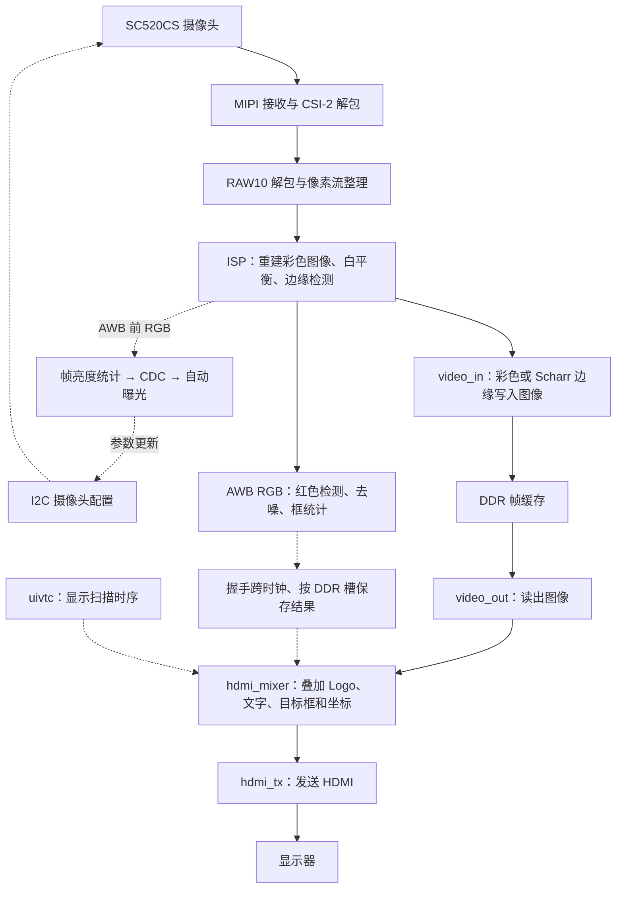

# 代码与配置导航

[返回工程首页](README.md)

这是一个包含摄像头、图像算法、外部存储器和显示接口的完整 FPGA 工程。先理解数据经过哪几个模块，再沿着模块名找对应文件。FPGA 模块通过信号连接并行工作；文件顺序不是软件程序的执行顺序。

本说明依据当前的 [TD 工程文件](td_project/anlogic_edge_osd.al)、[系统顶层](user_source/hdl_source/design_top_wrapper.v) 和 [ISP 顶层](user_source/hdl_source/isp/isp_top.v) 整理。

## 当前光照适应通路（2026-10-10）

曝光由 **AWB 前的亮度统计 → 请求/确认 CDC → AE 控制器 → 原 SC520CS I²C 表**
闭环调整；检测仍在 AWB 后、彩色/边缘选择之前。两种显示模式都使用同一份彩色
信息识别红色，Scharr 的核、阈值、11 拍选择器延迟和框补偿均保持原设置。

| 文件 | 当前功能 | 阅读入口 |
|---|---|---|
| [ae_frame_stats_96.v](user_source/hdl_source/isp/ae_frame_stats_96.v) | 每完整 720p 帧抽取 7,200 像素，累加 AWB 前非高光亮度并计总数/高光数；异常或截断帧不发布 | `first_beat`、`sample_beat`、`pixel_bright`、`sum_next`、`O_stats_valid` |
| [ae_stats_cdc.v](user_source/hdl_source/ae_stats_cdc.v) | 将 64 位帧结果整组送到约 23.81 MHz 域；相同值也产生更新脉冲 | `payload_hold`、`pending_data`、`req_toggle`、`ack_toggle` |
| [auto_exposure_control.v](user_source/hdl_source/auto_exposure_control.v) | 强光减亮、暗光增亮；等待实际 I²C 写入完成和 3 帧稳定时间 | `stats_ok`、`reduce_light`、`increase_light`、`state` |
| [awb.v](user_source/hdl_source/awb.v) | 近中性色采样、共享顺序除法、增益按帧提交和平滑；四像素输出为两拍 | `sample_neutral_d1`、`stats_ready`、`div_state`、`pixel_gain_r` |
| [red_target_detect_96.v](user_source/hdl_source/isp/red_target_detect_96.v) | 以通道比例和红色色相范围识别暗红，排除低饱和粉色；原多数滤波和框统计保留 | `gen_red`、`twice_red`、`hue_green_limit`、`votes` |

AE 默认写入曝光 1000、增益 16，控制范围分别为 4..1991、16..144。
`sum_y` 只累计 `Y<232` 的亮度；总采样数减去高光数即非高光数，
以非高光均值 96..128 为目标。非高光至少占 25% 才能偏暗增亮，
低于 12.5% 时减亮；达到 12.5% 但未到 25% 且偏暗时保持。
不再因少量亮屏/灯泡直接压暗整帧。
帧统计/CDC 不插入视频等待。原 `ae_set.v` 的手动控制已不再实例化，
顶层端口保留；K1 的彩色/边缘切换不变。两份 SDC 对 AE 载荷约束 20 ns，
只豁免请求/确认进入各自第一级同步寄存器的路径。

AWB 的像素乘法保持八个 DSP，共享顺序除法不再使用两份旧流水除法器 IP；
旧 AWB 延迟 RAM 也不再实例化。统计流水与像素流水相互独立，视频有效延迟为两拍。
完整参数、测试范围和实物验证限制见 [SC520CS_TEST.md](SC520CS_TEST.md)、
[sim/README.md](sim/README.md) 和 [README.md](README.md) 的最新章节。

## 当前试验版：红色目标与 Scharr 边缘并行

| 文件 | 当前功能 | 阅读入口 |
|---|---|---|
| [scharr_edge_detect_96.v](user_source/hdl_source/isp/scharr_edge_detect_96.v) | 全分辨率亮度边缘算法 | `luminance` → `gaussian` → `scharr` → `magnitude_direction` → `nms` |
| [red_target_detect_96.v](user_source/hdl_source/isp/red_target_detect_96.v) | AWB 输出上的四像素并行红色检测 | `red_mask` → 两行缓存与 `votes` → 框、中心与面积 |
| [rgb_edge_switch_96.v](user_source/hdl_source/isp/rgb_edge_switch_96.v) / [isp_top.v](user_source/hdl_source/isp/isp_top.v) | 在相同 RGB 源上并行检测并选择显示 | `u_red_target_detect_96`、`u_rgb_edge_switch`；两条视频路径延迟 11 拍 |
| [design_top_wrapper.v](user_source/hdl_source/design_top_wrapper.v) | 帧对应及坐标跨时钟传输 | `S_target_mailbox` 请求/确认 → `S_target_slots` 四槽表 → 当前读槽结果 |
| [camera_diag_cdc.v](user_source/hdl_source/camera_diag_cdc.v) | 摄像头 4 位配置状态及 8 位错误码的整组跨时钟传输 | `payload_hold` → 请求两级同步 → HDMI 接收 → 确认两级同步；由顶层 `u_camera_diag_cdc` 实例化 |
| [hdmi_mixer.v](user_source/hdl_source/hdmi_mixer.v) | 叠加前端框、十字和坐标 | `I_target_*` → `S_display_frame_start` → 框/十字/文字 |
| [anlogic_logo_rom.v](user_source/hdl_source/anlogic_logo_rom.v) | 精确保留原 Logo 颜色和透明度，用 ERAM 保存索引及调色板 | `index_addr_d` → `index_rom` → `palette_rom`；两拍读取，由 mixer 提前提供输入坐标 |
| [video_in.v](user_source/hdl_source/video_in.v) / [video_out.v](user_source/hdl_source/video_out.v) | 提供当前图像的 DDR 槽标记 | `O_write_frame_slot` / `O_read_frame_slot`；原地址与 FIFO 控制不变 |

检测在 **AWB 后、彩色/边缘切换前**，因此边缘模式仍能识别红色物体。
框按存图的实际 DDR 槽选择；边缘模式补偿轮廓向右 3 像素、向下 3 行的因果窗口偏移。
多数滤波忽略最外侧一像素边界；多个红色区域仍合为一个总包围框。
官方 `edge_detect_96.v`、旧 `color_edge_detect_96.v` 和 `color_target_detect.v`
留作历史对照，不在当前运行通路内。本版为高斯、Scharr、NMS及固定单阈值，
没有自适应阈值、色度边缘或 Canny 追踪；红色检测仍使用原始 RGB。
两份 `.al` 已登记新增算法；`sim/tb_*` 仅供仿真，不参与上板综合。
10 月 5 日 Scharr 替换时未改变摄像头配置、曝光、AWB 算法、板卡引脚或下载方式。
10 月 10 日曝光、AWB 和红色判定的更新见上节；初始化表、板卡引脚和下载设置保持。
Scharr 替换的改动为新增算法、选择器更换实例和延迟存储实现、
ISP 阈值注释和顶层横向补偿；RGB/模式/标记选择器延迟仍为 11 拍。
上表的红色检测、显示叠加及 DDR 槽管理均为已有功能。

## 1. 先认识整条数据通路



- **RAW/Bayer**：摄像头给出的原始感光数据，每个采样位置只对应一种颜色。demosaic 利用周围采样点重建 RGB。
- **ISP**：图像处理流水线的统称。本工程中包含彩色重建、白平衡、边缘检测和数据格式转换。
- **DDR**：存放图像帧，配合读写逻辑连接采集与显示的不同节拍。
- **OSD**：在原画面上叠加文字、数字、Logo。当前 Logo 使用两拍 ERAM 查表；mixer 从输入坐标提前寻址，最终 HDMI、视频数据及框的延迟保持原来的三拍。
- **IP**：工具或厂家提供的模块。一个 PLL、FIFO 或 DDR IP 可能需要配置文件、封装和多个下层源码，所以会占很多文件。

## 2. 最先读的五个文件

| 阅读顺序 | 文件 | 它负责什么 | 怎么读 |
|---|---|---|---|
| 1 | [design_top_wrapper.v](user_source/hdl_source/design_top_wrapper.v) | 系统连接、时钟/复位、外设接口和顶层配置 | 先搜 u_isp_top、u_video_in、u_video_out、u_hdmi_mixer，看它们连了哪些信号；再看各实例上面的参数 |
| 2 | [isp_top.v](user_source/hdl_source/isp/isp_top.v) | 串接图像处理模块 | 按 demosaic → data128_96 → awb → rgb_edge_switch_96 → data_96bit_to_128bit 阅读 |
| 3 | [scharr_edge_detect_96.v](user_source/hdl_source/isp/scharr_edge_detect_96.v) | 四像素独立的 Scharr 边缘 | 从 luminance、gaussian、scharr 读到 nms 和 scharr_window_4 |
| 4 | [hdmi_mixer.v](user_source/hdl_source/hdmi_mixer.v) | 叠加文字/Logo、计数以及调试图案 | 先看 LOGO_*、DYN_OSD_*，再看两个字库/Logo 实例以及最后的 DEBUG_MODE 输出选择 |
| 5 | [tb_scharr_edge_detect_96.sv](sim/tb_scharr_edge_detect_96.sv) | 图像域卷积参考与流式逐像素核对 | 先看 reference、build，再看 cycle、frame 和 reset_dut |

顶层文件中的 `isp_top u_isp_top (...)` 表示：模块类型是 isp_top，本次使用它的实例名是 u_isp_top。想看实现，就去找 `module isp_top`；同一个模块可以被实例化多次。

## 3. ISP 里面各文件的作用

| 阶段 | 当前使用的文件 | 输入与输出、作用 |
|---|---|---|
| 图像处理入口 | [isp_top.v](user_source/hdl_source/isp/isp_top.v) | 输入为 40 位 RAW 数据流，输出为供缓存使用的 128 位数据流 |
| 彩色重建 | [demosaic.v](user_source/hdl_source/isp/demosaic_4x_2_0/demosaic.v) | 处理 Bayer 原始采样；实例化窗口缓存和双线性插值 |
| 构造图像窗口 | [raw_matrix_3x3_buffer.v](user_source/hdl_source/isp/demosaic_4x_2_0/raw_matrix_3x3_buffer.v)、[line_buffer_demosaic.v](user_source/hdl_source/isp/demosaic_4x_2_0/line_buffer_demosaic.v) | 保留相邻行的数据，形成算法所需的邻域 |
| 插值计算 | [bilinear_interpolation.v](user_source/hdl_source/isp/demosaic_4x_2_0/bilinear_interpolation.v) | 根据 Bayer 排列和邻域数据计算彩色像素 |
| 像素格式转换 | [data128_96.v](user_source/hdl_source/isp/data128_96/data128_96.v) | 从四个 32 位位置取出 RGB888，并按代码规定的顺序拼成 96 位 |
| 曝光亮度统计 | [ae_frame_stats_96.v](user_source/hdl_source/isp/ae_frame_stats_96.v) | AWB 前的完整帧亮度/高光采样，独立接出统计 |
| 曝光反馈控制 | [ae_stats_cdc.v](user_source/hdl_source/ae_stats_cdc.v)、[auto_exposure_control.v](user_source/hdl_source/auto_exposure_control.v) | 64 位握手跨域后更新摄像头曝光/增益 |
| 自动白平衡 | [awb.v](user_source/hdl_source/awb.v) | 近中性色采样，红/蓝增益按帧更新；四个 RGB888 像素组成的 96 位数据保持两拍输出 |
| 边缘检测 | [scharr_edge_detect_96.v](user_source/hdl_source/isp/scharr_edge_detect_96.v) | 96 位 RGB 输入，亮度高斯、Scharr、NMS后输出同宽黑白边缘图 |
| 红色目标检测 | [red_target_detect_96.v](user_source/hdl_source/isp/red_target_detect_96.v) | 与边缘支路共享 AWB RGB 输入，不依赖显示模式 |
| 模式切换 | [rgb_edge_switch_96.v](user_source/hdl_source/isp/rgb_edge_switch_96.v) | 边缘模块持续运行；将彩色数据、模式和标志对齐为 11 拍，在帧首选择输出 |
| 板载 K1 控制 | [video_mode_control.v](user_source/hdl_source/video_mode_control.v) | 50 MHz 时钟下同步并消抖 20 ms，每次按下翻转一次模式请求 |
| DDR 数据打包 | [data96_128.v](user_source/hdl_source/isp/data96_128/data96_128.v) | 文件内的 data_96bit_to_128bit 模块把 96 位像素流重新打包为 128 位 |

新边缘每拍处理四个独立像素。亮度 `Y=floor((R+2G+B)/4)` 经高斯、
Scharr 和四方向 NMS 后，用 `abs(Gx)+abs(Gy)>=16*EDGE_TH` 判定。
白色为边缘，不复制相邻像素。详细数值和边界限制见 README 当前版说明。

常见接口信号：`tdata` 是数据，`tvalid` 表示数据有效，`tuser` 在这里表示帧首，`tlast` 表示行尾。`tready` 的实际支持情况需读实现；已有独立边缘仿真固定 ready=1，不能据此认定整条流水线支持任意反压。

## 4. 想改什么，就找哪个配置

下表是当前源码配置，不代表已通过真实硬件验证。文中的文件链接打开后，可以搜索“参数或关键词”列定位。

| 想做的修改 | 修改入口 | 参数或关键词 | 当前设置 / 注意事项 |
|---|---|---|---|
| 改边缘阈值 | [isp_top.v](user_source/hdl_source/isp/isp_top.v) | u_rgb_edge_switch、EDGE_TH | 单阈值 20；原始 Scharr 幅值门槛为 320 |
| 改红色判定 | [isp_top.v](user_source/hdl_source/isp/isp_top.v)、[red_target_detect_96.v](user_source/hdl_source/isp/red_target_detect_96.v) | u_red_target_detect_96、gen_red | RED_MIN=24、RED_DELTA=6、MIN_PIXELS=128，另有通道比例及红色色相 ±20° 条件 |
| 改自动曝光目标/范围 | [auto_exposure_control.v](user_source/hdl_source/auto_exposure_control.v) | TARGET_LOW/HIGH、EXPOSURE_*、GAIN_*、SETTLE_FRAMES | 非高光均亮 96..128；曝光 4..1991、增益 16..144；写完等待 3 个完整帧 |
| 改白平衡 | [awb.v](user_source/hdl_source/awb.v) | sample_neutral_d1、MIN/MAX_GAIN_Q8、F_smooth_gain | 未饱和近中性色采样，红/蓝增益 0.5..4 倍；差值 1/8 平滑，帧内固定 |
| 改上电默认模式 | [design_top_wrapper.v](user_source/hdl_source/design_top_wrapper.v)、[sc520_capture_top.v](user_source/hdl_source/sc520_capture_top.v) | ENABLE_EDGE | 主工程 0=彩色；如设为 1 则上电边缘；二者均可按 K1 切换 |
| 改边缘算法 | [scharr_edge_detect_96.v](user_source/hdl_source/isp/scharr_edge_detect_96.v) | gaussian、scharr、nms | 修改流水级数须同步切换延迟；修改窗口须同步顶层框补偿 |
| 改仿真阈值 | [tb_scharr_edge_detect_96.sv](sim/tb_scharr_edge_detect_96.sv) | TH、reference | 默认 20，不自动读取 isp_top；修改后需重新标定场景断言 |
| 改无板测试尺寸 | [tb_scharr_edge_detect_96.sv](sim/tb_scharr_edge_detect_96.sv)、[run_video_mode.cmd](sim/run_video_mode.cmd) | WIDTH、HEIGHT、SIZE_PARAMS | 默认 64×48；`--no-pause 720` 设为 1280×720、FAST=1 |
| 移动 Logo | [hdmi_mixer.v](user_source/hdl_source/hdmi_mixer.v) | LOGO_X、LOGO_Y | (0,0)；位置可先调整。LOGO_W/H=160×160 与 ROM 数据寻址配套，改大小不能仅改两个数字 |
| 改 Logo 图案 | [anlogic_logo_rom.v](user_source/hdl_source/anlogic_logo_rom.v) | O_pixel、I_addr | 保存 Logo 像素/有效标记，需要与 mixer 的地址计算一致 |
| 移动动态文字/计数 | [hdmi_mixer.v](user_source/hdl_source/hdmi_mixer.v) | DYN_OSD_X、DYN_OSD_Y | (375,120)；显示区域还受 DYN_OSD_W/H 和内部布局限制 |
| 改动态文字颜色 | [hdmi_mixer.v](user_source/hdl_source/hdmi_mixer.v) | COLOR_DYN_TEXT | 24'hfff200，按 RRGGBB 写颜色 |
| 改显示内容或字形 | [hdmi_mixer.v](user_source/hdl_source/hdmi_mixer.v)、[osd_char_lib.v](user_source/hdl_source/osd_char_lib.v) | S_pf_char、CHAR_*、I_char | mixer 选择显示的字符，字库存放图案；不是改一段普通字符串就能显示任意文字 |
| 切换彩条/状态图 | [design_top_wrapper.v](user_source/hdl_source/design_top_wrapper.v) | u_hdmi_mixer、DEBUG_MODE | 0=图像加OSD，1=彩条，2=按状态组合显示颜色，3=分区显示四个状态位；调试模式分支不叠加正常 OSD |
| 调整 Bayer 排列 | [isp_top.v](user_source/hdl_source/isp/isp_top.v) | u_demosaic、BAYER_MODE | BGGR；需匹配传感器实际排列及读出方向 |
| 查看摄像头初始化 | [uicfgcs520.v](user_source/hdl_source/uics520_cfg/uicfgcs520.v)、[uics520reg_720p60.v](user_source/hdl_source/uics520_cfg/uics520reg_720p60.v) | CLK_DIV、REG_DATA | 当前使用 SC520CS 1280×720@60 寄存器表；顶层 CLK_DIV=237，配置时钟约 23.809524 MHz，I²C 约 100 kHz |
| 查看摄像头 MIPI 配置 | [design_top_wrapper.v](user_source/hdl_source/design_top_wrapper.v) | u_mipi_dphy_rx_ph1p_mipiio_wrapper、LANE_NUM | 2 lane；需与摄像头寄存器配置和物理接线一致 |
| 查看显示时序 | [design_top_wrapper.v](user_source/hdl_source/design_top_wrapper.v) | u_hdmi_vtc | 有效尺寸 1280×720；行/帧总长 1650/750；水平同步 1390～1430，垂直同步 725～730 |
| 修改时钟 | [PLL IP](user_source/ip_source/PLL/)、[DDR IP](user_source/hdl_source/ph1p35_ddr/ddr2/) | TD 的 IP 配置与相应约束 | 存在多个时钟域，DDR 也有自身时钟逻辑；应通过对应 IP 配置生成并重新检查时序 |
| 修改板卡引脚 | [pin.adc](user_source/constraints_source/pin.adc) | 各顶层端口的约束 | 对应安路目标板；换 Xilinx 板卡还需要替换平台 IP 和约束，不能只改引脚名 |
| 查看实际顶层时序约束 | [anlogic_edge_osd.sdc](td_project/anlogic_edge_osd.sdc) | create_clock 等时序命令 | 这是 .al 当前登记的顶层 SDC；IP 还有配套约束 |

### 为什么修改了参数却没有效果

Verilog 的模块声明可以写默认参数，但上层实例化时可以覆盖它。例如：

```verilog
// scharr_edge_detect_96.v 中的默认值
parameter integer EDGE_TH = 20

// isp_top.v 中实例化时的配置，会覆盖默认值
rgb_edge_switch_96 #(
    .IMG_WIDTH(1280),
    .IMG_HEIGHT(720),
    .EDGE_TH(20)
) u_rgb_edge_switch (...);
```

TD 参数在 isp_top 实例中，独立仿真参数在 tb_scharr_edge_detect_96 的 TH 中。
比较前不截断梯度；阈值扩大 16 倍后比较。不要照搬旧 Sobel 或旧色差算法阈值。
本轮仿真及资源结果见 README。旧彩色色差报告不能代替 Scharr 的验证。

Logo 的 `index_rom` 保存 160×160 原图第 34～127 行的颜色索引，
`palette_rom[0]` 为透明，其他索引保存原始 25 位像素（有效位及 RGB）。
输入仍是原图线性地址 `y*160+x`，裁剪范围外返回透明。
改图案时要同时更新索引、调色板和裁剪范围，不能只改一个 RGB 常量。
两份 TD 工程仍直接登记同一个 ROM 文件，不依赖外部 `.mem` 文件。
`F_scale24_to16` 是原字号 `floor(16*x/24)` 的精确映射，
数字横向和冒号横向分别直接取坐标及左移一位；不改变字体的有效像素。

同理，hdmi_mixer 模块默认 H_OFFSET/V_OFFSET=128/60，但顶层实例传入的是 0/0；而当前 `O_video_rd_en = I_video_de`，不能仅凭参数名称认定它实现了画面平移。移动当前 Logo/文字，请从上述 LOGO_*、DYN_OSD_* 入手。

### 分辨率不是一个全局开关

当前尺寸在摄像头寄存器表、顶层 uial2axis、ISP 的 demosaic/AWB/edge 实例、HDMI 扫描时序及 mixer 中分别指定。更改尺寸还要检查 PLL 像素时钟、数据打包和 DDR 帧地址/读写长度等逻辑。先用现有 1280×720 系统及 64×48 当前独立仿真学习；不能只改某一处 IMG_WIDTH/IMG_HEIGHT 就视为完成整机分辨率切换。

## 5. 硬件接口文件何时需要读

| 任务 | 文件或目录 | 作用 |
|---|---|---|
| 摄像头没初始化 | [uics520_cfg/](user_source/hdl_source/uics520_cfg/)、[auto_exposure_control.v](user_source/hdl_source/auto_exposure_control.v) | 芯片 ID、初始化寄存器、I2C 错误及曝光/增益请求；实际 I²C 底层为 uicfgcs520.v 内的 sc520_i2c |
| MIPI 没收到数据 | [mipi_dphy_rx/](user_source/hdl_source/mipi_dphy_rx/) | 安路 MIPI 物理接收及字节/通道对齐，含加密 IP |
| 收到字节却没有像素帧 | [csi_unpacket_2lane.v](user_source/hdl_source/isp/csi_unpacket_2lane.v)、[raw10_unpacket_2lane.v](user_source/hdl_source/isp/raw10_unpacket_2lane.v)、[uial2axis.v](user_source/hdl_source/isp/uial2axis.v) | CSI-2 包解析、RAW10 像素提取、帧/行有效信号整理 |
| 图像写入/读出缓存异常 | [video_in.v](user_source/hdl_source/video_in.v)、[video_out.v](user_source/hdl_source/video_out.v) | FIFO、帧缓存指针、DDR 读写请求和数据宽度适配 |
| DDR 接口或初始化异常 | [mc_to_user_interface.v](user_source/hdl_source/mc_to_user_interface.v)、[ph1p35_ddr/](user_source/hdl_source/ph1p35_ddr/) | 用户侧请求与存储器控制器接口转换、DDR 控制器/PHY |
| HDMI 扫描位置异常 | [uivtc.v](user_source/hdl_source/vtc/uivtc.v)、[hdmi_mixer.v](user_source/hdl_source/hdmi_mixer.v) | 行同步、场同步、有效显示区域及 OSD 位置 |
| HDMI 输出接口异常 | [hdmi_tx.v](user_source/hdl_source/hdmi_tx.v)、[hdmi_phy_warpper.v](user_source/hdl_source/hdmi_phy_warpper.v)、[lane_lvds_10_1.v](user_source/hdl_source/lane_lvds_10_1.v) | 视频发送及物理串行输出，还依赖加密的 HDMI 内核 |

## 6. 同名文件、IP 配套文件怎么辨认

以下“当前使用”按 .al 文件路径以及顶层实例核对，路径不能只看最后一个文件名。

| 模块 | 当前使用的路径 | 容易误打开的另一份 |
|---|---|---|
| awb | [hdl_source/awb.v](user_source/hdl_source/awb.v) | [hdl_source/isp/awb/awb.v](user_source/hdl_source/isp/awb/awb.v) |
| signal_delay（历史保留，当前 AWB 不使用） | [hdl_source/signal_delay.v](user_source/hdl_source/signal_delay.v) | [hdl_source/isp/awb/signal_delay.v](user_source/hdl_source/isp/awb/signal_delay.v) |
| data_96bit_to_128bit | [hdl_source/isp/data96_128/data96_128.v](user_source/hdl_source/isp/data96_128/data96_128.v) | [hdl_source/data_96bit_to_128bit.v](user_source/hdl_source/data_96bit_to_128bit.v) |
| csi_unpacket_2lane | [hdl_source/isp/csi_unpacket_2lane.v](user_source/hdl_source/isp/csi_unpacket_2lane.v) | [hdl_source/uiisp_beta/csi_unpacket_2lane.v](user_source/hdl_source/uiisp_beta/csi_unpacket_2lane.v) |
| raw10_unpacket_2lane | [hdl_source/isp/raw10_unpacket_2lane.v](user_source/hdl_source/isp/raw10_unpacket_2lane.v) | [hdl_source/uiisp_beta/raw10_unpacket_2lane.v](user_source/hdl_source/uiisp_beta/raw10_unpacket_2lane.v) |

`image_correction.v` 虽然登记在 .al 中，但带有 `AutoExcluded=true`，当前顶层用直接连线绕过旧裁剪逻辑。看到一个文件在仓库里，甚至在工程登记清单里，也不能认定它一定生成了有效硬件。

| 文件形式 | 通常是什么 | 阅读/修改建议 |
|---|---|---|
| `.v`、`.sv`、`.vh`、`.vhd` | HDL 实现或头文件，也可能是 IP 生成源码 | 根据工程引用和模块层次确定作用 |
| `.enc.v`、`.enc.sv` | 加密 HDL/IP | 从封装端口和配置入手理解 |
| `.xml`、`.ipc`、`.params_*`、`.ports_*` | IP 的配置、参数和端口信息 | 与对应 IP 配套保留；配置变更优先使用 TD 的 IP 工具 |
| IP 目录下的 `RTL/`、`src/`、`DesignConfiguration.xml` | IP 下层实现及配置 | 未逐个列入顶层 .al，也可能由 IP 自动带入 |
| `.mif`、`.dat`、`.mem`、部分 `.txt` | ROM/RAM 初始化数据或配套描述 | 文件多不等于可删，要核对引用 |
| `.al` | TD 工程：器件、顶层、源文件与 IP 清单 | 新模块需要参与综合时，通过 TD 加入并保存 |
| `.adc`、`.sdc`、部分 `.tcl` | 引脚、时序约束或工具脚本 | 从 .al / IP 配置确认实际使用哪一份 |
| `sim/tb_*.sv`、`sim/*.cmd`、`sim/*.do` | 测试台和仿真启动脚本 | 用来验证设计；测试台不要作为 TD 综合源码加入 |

文件不在 .al 的显式清单中，不等于没用：可能是 IP 的下层依赖、include 文件、初始化数据或仿真辅助文件。当前导航不据此删除任何文件。

## 7. 无板子时，第一次学习这样做

以下步骤用于学习保留的官方灰度 Sobel 对照，阈值 80 是旧算法配置。当前 Scharr
使用单阈值 20，入口为 `run_video_mode.cmd`，测试台为 `tb_scharr_edge_detect_96.sv`。

1. 打开 [tb_edge_detect.sv](sim/tb_edge_detect.sv)，找到 `THRESHOLD = 80`，观察它如何传给 DUT；再打开 [edge_detect_96.v](user_source/hdl_source/isp/edge_detect_96.v)，找到 `mag0 >= EDGE_TH`。
2. 按 [仿真说明](sim/README.md) 运行 run_xsim.cmd，确认输出 PASS；查看本地生成的输入图片与边缘图片。
3. 可以把旧测试台 THRESHOLD 改为 160 后重新仿真。对于同一输入，更高阈值通常会留下更少边缘；测试台会按自己的参考计算检查输出。当前 TD 系统使用已缩放的彩色梯度，应单独标定阈值，不要直接照搬旧灰度数值。
4. 理解边缘模块后，再研究 mixer 的 Logo/文字坐标。现有测试台没有验证 OSD，修改它需要补 OSD 仿真或上板观察。

独立灰度边缘模块历史仿真见 [validation.txt](sim/validation.txt)；2026-10-02 已适配 SC520CS，并增加彩色工程，详情见 [SC520CS_TEST.md](SC520CS_TEST.md)。用户已确认基础版本有板上画面；当前替换算法的版本仍需重新生成 bit 后验证。

## 8. TD 显式登记的文件索引

下面的索引从当前 .al 提取；新增模块或更换 IP 后，应与 .al 一起更新。它列出登记入口，不展开 IP 的所有内部依赖，也不等同于最终综合网表中保留的模块。

<details>
<summary>展开：当前 TD 主工程的 65 个登记文件及作用</summary>

| 文件 | 作用 | 登记状态 |
|---|---|---|
| [user_source/hdl_source/design_top_wrapper.v](user_source/hdl_source/design_top_wrapper.v) | 系统顶层、外设连线和实例参数 | 已登记 |
| [user_source/hdl_source/video_in.v](user_source/hdl_source/video_in.v) | 输入图像 FIFO、写帧指针与 DDR 写请求 | 已登记 |
| [user_source/hdl_source/video_out.v](user_source/hdl_source/video_out.v) | DDR 读请求、输出 FIFO 与显示像素读出 | 已登记 |
| [user_source/hdl_source/mc_to_user_interface.v](user_source/hdl_source/mc_to_user_interface.v) | 用户读写请求转换为 DDR 控制器接口 | 已登记 |
| [user_source/hdl_source/signal_delay.v](user_source/hdl_source/signal_delay.v) | 旧 AWB 延迟模块；当前不使用 | AutoExcluded=true |
| [user_source/hdl_source/awb.v](user_source/hdl_source/awb.v) | 近中性色采样及帧稳定自动白平衡 | 已登记 |
| [user_source/hdl_source/isp/ae_frame_stats_96.v](user_source/hdl_source/isp/ae_frame_stats_96.v) | 完整帧曝光亮度/高光采样 | 已登记 |
| [user_source/hdl_source/ae_stats_cdc.v](user_source/hdl_source/ae_stats_cdc.v) | 曝光统计握手跨时钟邮箱 | 已登记 |
| [user_source/hdl_source/auto_exposure_control.v](user_source/hdl_source/auto_exposure_control.v) | 帧反馈曝光/增益控制器 | 已登记 |
| [user_source/hdl_source/camera_diag_cdc.v](user_source/hdl_source/camera_diag_cdc.v) | 12 位摄像头状态/故障码握手跨时钟 | 已登记 |
| [user_source/hdl_source/ph1p35_ddr/ph1p35_324_ddr_wrapper.v](user_source/hdl_source/ph1p35_ddr/ph1p35_324_ddr_wrapper.v) | 安路 PH1P35 DDR 封装 | 已登记 |
| [user_source/hdl_source/isp/csi_unpacket_2lane.v](user_source/hdl_source/isp/csi_unpacket_2lane.v) | 双 lane CSI-2 包解析 | 已登记 |
| [user_source/hdl_source/isp/isp_top.v](user_source/hdl_source/isp/isp_top.v) | 图像处理流水线顶层 | 已登记 |
| [user_source/hdl_source/isp/raw10_unpacket_2lane.v](user_source/hdl_source/isp/raw10_unpacket_2lane.v) | RAW10 像素解包 | 已登记 |
| [user_source/hdl_source/isp/uial2axis.v](user_source/hdl_source/isp/uial2axis.v) | 整理像素数据及帧首/行尾有效信号 | 已登记 |
| [user_source/hdl_source/isp/demosaic_4x_2_0/bilinear_interpolation.v](user_source/hdl_source/isp/demosaic_4x_2_0/bilinear_interpolation.v) | Bayer 双线性插值 | 已登记 |
| [user_source/hdl_source/isp/demosaic_4x_2_0/demosaic.v](user_source/hdl_source/isp/demosaic_4x_2_0/demosaic.v) | 彩色重建子系统入口 | 已登记 |
| [user_source/hdl_source/isp/demosaic_4x_2_0/line_buffer_demosaic.v](user_source/hdl_source/isp/demosaic_4x_2_0/line_buffer_demosaic.v) | 彩色重建的行缓存 | 已登记 |
| [user_source/hdl_source/isp/demosaic_4x_2_0/mipi_to_raw_converter.v](user_source/hdl_source/isp/demosaic_4x_2_0/mipi_to_raw_converter.v) | 彩色重建前的 RAW 数据整理 | 已登记 |
| [user_source/hdl_source/isp/demosaic_4x_2_0/raw_matrix_3x3_buffer.v](user_source/hdl_source/isp/demosaic_4x_2_0/raw_matrix_3x3_buffer.v) | 构造相邻行的 3×3 像素窗口 | 已登记 |
| [user_source/hdl_source/isp/demosaic_4x_2_0/zhenghe.v](user_source/hdl_source/isp/demosaic_4x_2_0/zhenghe.v) | 彩色重建路径的数据整合配套模块 | 已登记 |
| [user_source/hdl_source/isp/data128_96/data128_96.v](user_source/hdl_source/isp/data128_96/data128_96.v) | 从 128 位格式提取并重排四个 RGB888 像素 | 已登记 |
| [user_source/hdl_source/isp/data96_128/data96_128.v](user_source/hdl_source/isp/data96_128/data96_128.v) | 提供当前使用的 data_96bit_to_128bit 打包模块 | 已登记 |
| [user_source/hdl_source/image_correction.v](user_source/hdl_source/image_correction.v) | 旧图像裁剪模块；当前顶层直接旁路 | AutoExcluded=true |
| [user_source/hdl_source/uics520_cfg/SC520GainTbl.v](user_source/hdl_source/uics520_cfg/SC520GainTbl.v) | SC520CS 模拟及数字增益映射 | 已登记 |
| [user_source/hdl_source/uics520_cfg/uicfgcs520.v](user_source/hdl_source/uics520_cfg/uicfgcs520.v) | 芯片 ID 检查、初始化、曝光/增益配置及错误处理 | 已登记 |
| [user_source/hdl_source/uics520_cfg/uics520reg_720p60.v](user_source/hdl_source/uics520_cfg/uics520reg_720p60.v) | SC520CS 720p60 初始化寄存器表 | 已登记 |
| [user_source/hdl_source/uics520_cfg/uics520regAE.v](user_source/hdl_source/uics520_cfg/uics520regAE.v) | SC520CS 曝光/增益及 group hold 数据生成 | 已登记 |
| [user_source/hdl_source/uics500_cfg/uii2c.v](user_source/hdl_source/uics500_cfg/uii2c.v) | 旧通用 I2C；当前使用 sc520_i2c | AutoExcluded=true |
| [user_source/hdl_source/uiisp_beta/ae_set.v](user_source/hdl_source/uiisp_beta/ae_set.v) | 旧手动曝光/增益请求；当前未实例化 | AutoExcluded=true |
| [user_source/hdl_source/hdmi_tx.v](user_source/hdl_source/hdmi_tx.v) | HDMI 发送子系统封装 | 已登记 |
| [user_source/hdl_source/hdmi_1_4b_transmitter_core_wrapper.enc.v](user_source/hdl_source/hdmi_1_4b_transmitter_core_wrapper.enc.v) | 加密 HDMI 发送内核封装 | 已登记 |
| [user_source/hdl_source/hdmi_phy_warpper.v](user_source/hdl_source/hdmi_phy_warpper.v) | HDMI 物理输出封装 | 已登记 |
| [user_source/hdl_source/lane_lvds_10_1.v](user_source/hdl_source/lane_lvds_10_1.v) | 输出通道串行化配套模块 | 已登记 |
| [user_source/hdl_source/vtc/uivtc.v](user_source/hdl_source/vtc/uivtc.v) | 显示扫描、同步和有效区时序 | 已登记 |
| [user_source/hdl_source/hdmi_mixer.v](user_source/hdl_source/hdmi_mixer.v) | 图像、Logo、文字/帧计数与调试画面混合 | 已登记 |
| [user_source/hdl_source/I2S_receiver.v](user_source/hdl_source/I2S_receiver.v) | HDMI 子系统的 I2S 音频接收配套模块 | 已登记 |
| [user_source/hdl_source/audio_arc_calculate.v](user_source/hdl_source/audio_arc_calculate.v) | HDMI 音频时钟恢复参数计算 | 已登记 |
| [user_source/hdl_source/key_remove_shakes.v](user_source/hdl_source/key_remove_shakes.v) | HDMI 子系统配套按键消抖 | 已登记 |
| [user_source/hdl_source/isp/edge_detect_96.v](user_source/hdl_source/isp/edge_detect_96.v) | 历史 Sobel 边缘检测 | AutoExcluded=true |
| [user_source/hdl_source/isp/scharr_edge_detect_96.v](user_source/hdl_source/isp/scharr_edge_detect_96.v) | 当前高斯、Scharr、NMS 和 ERAM 行窗口 | 已登记 |
| [user_source/hdl_source/isp/color_edge_detect_96.v](user_source/hdl_source/isp/color_edge_detect_96.v) | 旧彩色色差边缘；未在当前通路实例化 | AutoExcluded=true |
| [user_source/hdl_source/isp/red_target_detect_96.v](user_source/hdl_source/isp/red_target_detect_96.v) | 当前独立 RGB 红色目标检测 | 已登记 |
| [user_source/hdl_source/color_target_detect.v](user_source/hdl_source/color_target_detect.v) | 旧目标检测；未在当前通路实例化 | AutoExcluded=true |
| [user_source/hdl_source/isp/rgb_edge_switch_96.v](user_source/hdl_source/isp/rgb_edge_switch_96.v) | 彩色/边缘对齐及帧边界选择 | 已登记 |
| [user_source/hdl_source/video_mode_control.v](user_source/hdl_source/video_mode_control.v) | K1 输入同步、消抖与模式请求 | 已登记 |
| [user_source/hdl_source/anlogic_logo_rom.v](user_source/hdl_source/anlogic_logo_rom.v) | 安路 Logo 像素 ROM | 已登记 |
| [user_source/hdl_source/osd_char_lib.v](user_source/hdl_source/osd_char_lib.v) | OSD 字符点阵 | 已登记 |
| [user_source/hdl_source/mipi_dphy_rx/mipi_dphy_rx_ph1p_mipiio_wrapper.sv](user_source/hdl_source/mipi_dphy_rx/mipi_dphy_rx_ph1p_mipiio_wrapper.sv) | MIPI D-PHY 接收入口 | 已登记 |
| [user_source/hdl_source/mipi_dphy_rx/ph1p_mipiio_rx_wrapper.v](user_source/hdl_source/mipi_dphy_rx/ph1p_mipiio_rx_wrapper.v) | 安路 MIPI IO 接收封装 | 已登记 |
| [user_source/hdl_source/mipi_dphy_rx/byte_aligner.enc.v](user_source/hdl_source/mipi_dphy_rx/byte_aligner.enc.v) | 加密字节对齐模块 | 已登记 |
| [user_source/hdl_source/mipi_dphy_rx/byte_aligner_wrapper.enc.sv](user_source/hdl_source/mipi_dphy_rx/byte_aligner_wrapper.enc.sv) | 加密字节对齐封装 | 已登记 |
| [user_source/hdl_source/mipi_dphy_rx/channel_aligner.enc.v](user_source/hdl_source/mipi_dphy_rx/channel_aligner.enc.v) | 加密通道对齐模块 | 已登记 |
| [user_source/hdl_source/mipi_dphy_rx/channel_aligner_wrapper.enc.sv](user_source/hdl_source/mipi_dphy_rx/channel_aligner_wrapper.enc.sv) | 加密通道对齐封装 | 已登记 |
| [user_source/hdl_source/mipi_dphy_rx/hs_detect.enc.v](user_source/hdl_source/mipi_dphy_rx/hs_detect.enc.v) | 加密高速接收检测模块 | 已登记 |
| [user_source/constraints_source/pin.adc](user_source/constraints_source/pin.adc) | 当前顶层引脚约束 | 已登记 |
| [td_project/anlogic_edge_osd.sdc](td_project/anlogic_edge_osd.sdc) | 当前顶层时序约束 | 已登记 |
| [user_source/ip_source/PLL/PLL.xml](user_source/ip_source/PLL/PLL.xml) | 系统时钟 PLL 的 IP 配置入口 | 已登记 |
| [user_source/ip_source/w128_d512_fifo/w128_d512_fifo.xml](user_source/ip_source/w128_d512_fifo/w128_d512_fifo.xml) | 128 位、512 深度 FIFO 的 IP 配置入口 | 已登记 |
| [user_source/ip_source/w155_d512_fifo/w155_d512_fifo.xml](user_source/ip_source/w155_d512_fifo/w155_d512_fifo.xml) | 155 位、512 深度 FIFO 的 IP 配置入口 | 已登记 |
| [user_source/ip_source/blk_mem_gen_awb_delay_signal/blk_mem_gen_awb_delay_signal.xml](user_source/ip_source/blk_mem_gen_awb_delay_signal/blk_mem_gen_awb_delay_signal.xml) | 旧 AWB 延迟 RAM；当前不使用 | AutoExcluded=true |
| [user_source/ip_source/divider/divider.ipc](user_source/ip_source/divider/divider.ipc) | 旧 AWB 流水除法器；当前不使用 | AutoExcluded=true |
| [user_source/hdl_source/ph1p35_ddr/ddr2/ddr2.xml](user_source/hdl_source/ph1p35_ddr/ddr2/ddr2.xml) | DDR2 控制器 IP 配置入口 | 已登记 |
| [user_source/hdl_source/isp/demosaic_4x_2_0/blk_mem_gen_zhenghe/blk_mem_gen_zhenghe.xml](user_source/hdl_source/isp/demosaic_4x_2_0/blk_mem_gen_zhenghe/blk_mem_gen_zhenghe.xml) | 数据整合配套 RAM 的 IP 配置入口 | 已登记 |
| [user_source/hdl_source/isp/demosaic_4x_2_0/blk_mem_gen_demosaic/blk_mem_gen_demosaic.xml](user_source/hdl_source/isp/demosaic_4x_2_0/blk_mem_gen_demosaic/blk_mem_gen_demosaic.xml) | 彩色重建配套 RAM 的 IP 配置入口 | 已登记 |

</details>

当前 Scharr、红色检测、按键、选择器及三个 AE 模块均已登记到两个工程。主工程现有 65 个登记入口；上表的 AutoExcluded 状态按主工程记录。

彩色工程 `td_project/anlogic_sc520_capture.al` 另加 [sc520_capture_top.v](user_source/hdl_source/sc520_capture_top.v)，并使用自己的 `anlogic_sc520_capture.sdc`，共 66 个登记入口。旧文件在两份工程中的 AutoExcluded 标记可能不同，是否生成硬件仍以实例化和网表为准。该顶层以 `ENABLE_EDGE=0` 实例化系统顶层；主工程默认同样为 `ENABLE_EDGE=0`。此参数现在只指定复位后的模式，运行中均可按板载 K1（D5）切换。

