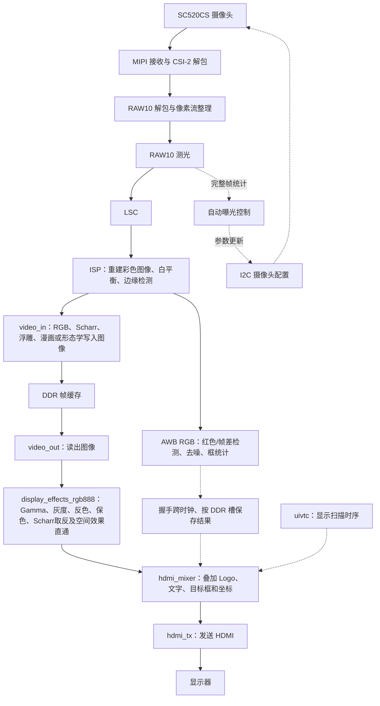

# 代码与配置导航

[返回工程首页](../README.md)

这是一个包含摄像头、图像算法、外部存储器和显示接口的完整 FPGA 工程。先理解数据经过哪几个模块，再沿着模块名找对应文件。FPGA 模块通过信号连接并行工作；文件顺序不是软件程序的执行顺序。

本说明依据当前的 [TD 工程文件](../td_project/anlogic_edge_osd.al)、[系统顶层](../user_source/hdl_source/design_top_wrapper.v) 和 [ISP 顶层](../user_source/hdl_source/isp/isp_top.v) 整理。

## 当前多颜色目标版

主工程默认 `RED_MULTI_ENABLE=1`。K2 的红、绿、蓝模式最多 4 框，保留九项显示算法；
运动仍为单总框。颜色检测使用全分辨率多数滤波后的有界行段连接、Top4 和四槽跟踪，
不是完整 CCL。两帧确认、漏检保持两帧，容量溢出整帧无效并显示 OVF。
跟随标签为 `1 RED/GRN/BLU OK` / `H`，紧凑标签为 `1 OK` / `1 H`；
左下显示 `RED/GRN/BLU COUNT:0..4` 或 `MOV COUNT:0..1`。
实际操作与限制见[红色多目标说明](RED_MULTI_TARGET.md)。

当前发布 `src-226b3d8abb02` 已通过最终布局布线并生成 bit：Slice 18,341/21,216（86.45%）、
LUT6 17,562、寄存器 17,822、ERAM 79/108、DSP 17/40，
建立/保持余量 +0.021/+0.020 ns。相对上一已发布版增加 235 Slice 和 140 LUT6，
ERAM/DSP 不变。两份 bit SHA256 均为
`EED6860A0D9C6AB5D16CB846A090E40A82DB0EFE5D89B5A787B4AA80E237CCFC`，
身份见 [发布清单](../build/release/release_manifest.json)。

## 2026-10-17 九项显示模式

K1（D5）按 0..8 单向循环选择模式，按下/释放均消抖 20 ms。
K3（B9）与 K4（C7）保留引脚但不执行操作。
K2（A9）独立按红色、绿色、蓝色、运动循环，仍按原逻辑消抖。
屏幕在 (192,80) 显示编号和名称；默认原画带 Gamma，无参数显示。

| 模式 | 算法 | 说明 |
|---|---|---|
| 0 | 原画 + Gamma | 上电默认，沿用原曲线 |
| 1 | 灰度 | `Y=(77*R+150*G+29*B+128)>>8`，三通道输出 Y |
| 2 | 原 Scharr 边缘 | 保留原高斯、Scharr、NMS 和固定单阈值 |
| 3 | RGB 反色 | 每通道 `255-C` |
| 4 | 灰度浮雕 | `E=clip(128+2*(Y中心-Y左上),0,255)`，平坦区域中灰、轮廓成对明暗边 |
| 5 | 红绿保色 | 满足红/绿色条件的像素保留 RGB，其他使用模式 1 灰度 |
| 6 | 彩色漫画 | RGB5 的 3×3 高斯平滑、RGB3 色阶与原 Scharr/NMS 黑轮廓 |
| 7 | Scharr 反色 | CSI 选择原 Scharr 正边缘，HDMI 取反为白底黑边 |
| 8 | 形态学边缘 | 第一层灰度 3×3 的 `clip(4*(max-min),0,255)` |

K3/K4 单独或与 K1 同时按下均不影响 K1 的单向循环。12 位配置接口仍为 4 位模式加 8 位兼容参数，
控制器将参数固定为 0，像素处理忽略参数。Scharr 内部灰度沿用
`Y=(R+2*G+B)>>2`，浮雕复用此灰度的第一层 3×3 窗口；
浮雕前两行、前两列输出中灰 128。漫画前六行、前六列填黑，形态学前两行、前两列填黑。
九项模式的本轮独立整数参考、综合、布局布线与 bit 生成均已通过，见 [仿真说明](../sim/README.md)。

| 文件 | 职责 | 阅读入口 |
|---|---|---|
| [display_effect_control.v](../user_source/hdl_source/display_effect_control.v) | 50 MHz 域的 K1 同步、消抖和九项单向循环请求；K3/K4 无操作、参数固定 0 | `MODE_COUNT`、`O_effect_mode` |
| [design_top_wrapper.v](../user_source/hdl_source/design_top_wrapper.v) | 12 位配置跨入 CSI；默认多目标，并将实际帧配置和框随 DDR 槽保存到 HDMI | `RED_MULTI_ENABLE`、`u_display_effect_cdc`、`u_target_frame_bridge`、`S_effect_config_hdmi` |
| [target_frame_bridge.v](../user_source/hdl_source/target_frame_bridge.v) | 将原帧 ID/代次、完整写帧和实际读槽冻结绑定，整组元数据握手跨域 | `I_frame_id`、`I_write_start`、`I_read_start` |
| [rgb_edge_switch_96.v](../user_source/hdl_source/isp/rgb_edge_switch_96.v) | 帧首提交，模式 2/7 选正 Scharr、4 选浮雕、6 选漫画、8 选形态学，其余 RGB；统一 11 拍 | `I_effect_config`、`O_effect_config` |
| [scharr_edge_detect_96.v](../user_source/hdl_source/isp/scharr_edge_detect_96.v) | 原高斯、Scharr、NMS；共享灰度窗口浮雕/形态学和低位宽彩色窗口漫画 | `gw`、`sw`、`O_morph_data`、`cartoon_channel`、`O_cartoon_data` |
| [hdmi_mixer.v](../user_source/hdl_source/hdmi_mixer.v) | 帧首锁存实际槽配置，显示九项名称，复用目标文字字库 | `S_effect_mode`、`S_effect_char` |
| [display_effects_rgb888.v](../user_source/hdl_source/display_effects_rgb888.v) | 原画 Gamma、灰度、反色、红绿保色与 Scharr 取反，其余空间效果直通，固定两拍 | `luma_rgb`、`keep_red_green`、`mode_d`、`O_rgb` |

目标框按实际帧配置，在模式 2 Scharr、6 漫画和 7 Scharr 反色下向右、向下各补偿 3 像素，
在模式 4 浮雕和 8 形态学下各补偿 1 像素，其余模式不偏移。
兼容信号 `O_edge_mode` 仍只在模式 2 置位，实际路由使用完整模式配置。
配置与像素同步经过 DDR 槽，即使显示旧帧或重复帧，算法名也对应实际画面。
效果模块替代 mixer 原有两拍像素寄存，最终 HDMI 输出仍为三拍；OSD 后叠加。

浮雕复用已有窗口，不新增 DDR 访问或行缓存；乘 2 使用移位。
漫画新增 RGB5 高斯行缓存和 RGB3 颜色中心对齐行缓存，不增加 DDR 访问。
颜色通道先平滑，再取八级色阶并扩展回 8 位，最后将原 NMS 轮廓置黑。
红绿保色不使用该邻域缓存，在 HDMI 端按 RGB 通道条件处理。
新增 Scharr 反色与形态学复用已有正边缘和第一层灰度窗口，不增加行缓存、DSP 或 DDR 图像访问。
本轮控制器通过 468 项检查，像素模块通过 709,647 次参考对照，
名称/mixer 核对 28 帧、3,612,672 个像素；DDR 对齐覆盖全部九项模式。
720p 核心核对 22 帧、18,439,680 个像素，新增两模式的红色/运动配置共四项 ISP 打包也已通过。
这些九模式历史基线与当前多目标结果分别见 [仿真说明](../sim/README.md)。
浮雕[合成输入](../build/verification/emboss_synthetic_input.png)与
[RTL 输出](../build/verification/emboss_synthetic_rtl.png)可对照；它们不是实物摄像头画面。
漫画[合成输入](../build/verification/cartoon_synthetic_input.png)与
[RTL 输出](../build/verification/cartoon_synthetic_rtl.png)也仅来自合成场景。
红绿保色的[RTL 对照预览](../build/verification/color_keep_rtl_preview.png)同样不代替实拍。

九模式单框历史基线 `src-0917069cbe5c` 于 2026-10-17 20:11:21（北京时间）完成构建。
当时最终 Slice 16,035/21,216（75.58%）、LUT6 14,773、寄存器 13,573、
ERAM 69/108、DSP 13/40，建立/保持余量 +0.128/+0.020 ns。
显示配置跨时钟的 13 ns 规则覆盖全部 4 条有效路径，未被宽松规则覆盖或忽略。
相对七模式基线增加 789 Slice、796 LUT6、387 个寄存器，ERAM 与 DSP 不变。
当时 221 个生产构建输入与当时文件 SHA256 一致；当前资源和 bit 身份以上节多目标版及发布清单为准。

资源和时序报告位于 [资源报告](../build/release/system_phy.area) 与
[最终时序](../build/release/system_pr.timing)，需结合清单的源码指纹判断版本。
根目录构建入口成功后更新 `td_project/anlogic_edge_osd_Runs/best_result/anlogic_edge_osd.bit`
和 `firmware` 副本。固定报告路径随成功构建更新，需按
[构建清单](../build/release/release_manifest.json) 核对源码身份。本轮回归日志和源码校验值见
[九模式历史验证证据包](../build/verification/algorithm_regression.zip)；
Scharr 反色与形态学在红色/运动两种检测配置的 ISP 选择与打包检查均通过；
真实摄像头画质仍待重新烧录后确认。
当前红色最多四框、运动一个总框，使用说明见[红色多目标说明](RED_MULTI_TARGET.md)。
[低资源连通区域方案](CONNECTED_COMPONENTS_PLAN.md)是尚未实现的完整 CCL 历史提案，
与当前有界行段连接实现不同。

## 前版固定色调查表与资源基线（2026-10-17）

[gamma_lut_rgb888.v](../user_source/hdl_source/gamma_lut_rgb888.v) 在 HDMI 单像素
时钟域处理 RGB888。前版以默认开启的 `GAMMA_ENABLE` 替代 mixer 的第一拍
像素寄存；当前由上节效果模块在模式 0 的彩色图上启用该表。
调试模式 1/2/3 保持原有诊断路径。

曲线为固定双向色调映射，节点之间线性插值、四舍五入（半值向上），
完整 256 项表已写入源码，不需要额外加载文件或硬件插值：

```text
input : 0, 16, 32, 64,  96, 128, 160, 192, 224, 240, 255
output: 0, 23, 44, 80, 104, 128, 152, 180, 210, 232, 255
```

调整节点时，需要离线重新生成 `TONE_LUT` 十六进制常量，并同步更新仿真参考；
仅修改文件头的节点注释不会改变硬件曲线。

三通道使用同一条曲线、三个独立地址；用安路 `rom_style="none"` 约束为逻辑 ROM。
表前仍是原 AWB/检测/DDR 通路，表后才叠加 Logo、文字、框和延迟面板。
中性灰保持中性；彩色的饱和度和色相可能变化，节点尚需实拍确认。
0/255 端点保持；已经剪白的细节需要从曝光端避免丢失。
独立查表及完整 HDMI 检查入口见 [sim/README.md](../sim/README.md)。

前版 TD 6.2 主工程验证版本为 `src-76e47c9e8758`，仅综合和布局布线，未生成 bit。
改动前精确源码基线为 `src-101128745312`；同阶段 Gate Slice 估算从 13,736
增至 13,826（+90），寄存器仍为 12,929，ERAM 仍为 62，DSP 仍为 13。
最终 Routed 占用 Slice 14,609/21,216（68.86%）、寄存器 12,624，
ERAM 62/108、DSP 13/40；现有约束下建立余量 +0.181 ns、保持 +0.020 ns。
Gate 增量不能与 Routed 占用混算。
报告和源哈希保存在
`%TEMP%/anlogic_image_quality_55b224aa056449fda19b046578ca1771/`；
该次检查未更新 `build/release`、`firmware` 和 TD 的 `best_result`。

## 2026-10-16 处理延迟可视化

HDMI 右上角显示同帧总延迟、ISP 延迟、缓存与输出等待、累计最小/最大值，
以及最近 64 个显示帧的曲线。当前按键定义以上节统一算法选择为准。

| 文件 | 当前功能 | 阅读入口 |
|---|---|---|
| [video_latency_timebase.v](../user_source/hdl_source/video_latency_timebase.v) | 50 MHz 系统时钟产生微秒时间和寄存 Gray 编码 | `O_time_us`、`O_time_gray` |
| [video_latency_monitor.v](../user_source/hdl_source/video_latency_monitor.v) | RAW/ISP 首像素时间、实际 DDR 槽位和 HDMI 显示帧配对 | `S_raw_times`、`S_start_raw_us`、`S_slot_raw`、`S_read_payload`、`O_sample_strobe` |
| [video_latency_osd.v](../user_source/hdl_source/video_latency_osd.v) | 共享十进制转换、64 帧历史、数字和曲线绘制 | `bcd_work`、`history`、`O_panel`、`O_text`、`O_graph` |

帧号经过 ISP 行缓存和打包器随真实图像传递，读记录在 DDR 实际选择基地址时冻结。
`video_in.v` 的 `O_write_frame_start/O_write_start_slot` 提供实际写槽分配事件，
`video_out.v` 的 `O_read_frame_start` 提供实际读地址选择事件，
`hdmi_mixer.v` 的 `O_display_frame_start` 对齐最终首个输出像素。
测量范围、无效样本及资源/时序见 [延迟可视化说明](LATENCY_VISUALIZATION.md)。

## 2026-10-16 K2 帧差运动检测与稳定处理

K2（A9）切换红色/运动检测，当前 K1 单向循环显示算法，K3/K4 无操作。
两种检测从 AWB RGB 分流，持续运行，帧首锁定 K2 模式。
结果的算法标签随实际 DDR 帧槽保存，显示帧首锁存为 `RED` / `MOV`。

| 文件 | 当前功能 | 阅读入口 |
|---|---|---|
| [motion_target_detect_96.v](../user_source/hdl_source/isp/motion_target_detect_96.v) | 8×8 灰度均值相邻帧差，片上参考 RAM，邻域过滤、有效支持计数与同向光照事件 | `beat_compare` → `block_sum` → `u_reference` → `difference` → `votes` → `snapshot_found` / `snapshot_scene_change` |
| [target_detect_switch_96.v](../user_source/hdl_source/isp/target_detect_switch_96.v) | K2 请求同步、帧首模式与末拍结果绑定；同文件帧级稳定器 | `u_motion` → `gen_stable_motion.u_stabilizer`、`candidate`、`boxes_match`、`confirmations`、`smooth_coordinate` |
| [tb_motion_target_detect_96.sv](../sim/tb_motion_target_detect_96.sv) | 图像参考、算法切换及 720p 参考缓存全地址验证 | `expect_image`、`tb_target_detect_switch_96`、`tb_motion_full_resolution` |

运动参数在 `isp_top.v` 的 `u_target_detect_switch` 实例设置：
`DIFF_THRESHOLD=10`、`MIN_BLOCKS=12`、`GLOBAL_CHANGE_PERCENT=40`。
稳定器默认开启：至少 8 个支持块，`3×支持块数 >= 2×(框宽块数+框高块数)`，
连续 3 帧确认、漏检保持 2 帧、第三次清除、8 像素死区与四分之一平滑。
坏参考和大范围光照事件立即清除。原始模块直接实例化的默认值仍为 6/8，
旧算法与选择器回归显式使用该配置，不能作为生产稳定参数的验证结果。
稳定运动结果仿真可见延迟为 13 拍；6 拍红色结果仅适用于关闭多目标的旧单框分支，
当前红色结果由行段队列与串行处理完成后携带原帧号提交，不是固定 6 拍。
使用说明和本次 bit 见 [VIDEO_MODE_SWITCH.md](VIDEO_MODE_SWITCH.md)。

## 2026-10-14 HDMI 九区通道读数（默认关闭）

`design_top_wrapper.v` 默认 `SHOW_RAW_STATS=0`，九区数字表及其 E/G/AE 表头不显示，
对应分区统计器、诊断邮箱和数字表不实例化。现有 LSC、AE RAW 测光和 AWB 保留；
曝光由 `auto_exposure_control.v` 闭环调节，范围 E4..1991/G16..176。

诊断时设 `SHOW_RAW_STATS=1` 并重新编译下载，在去马赛克前旁路采样：`isp/raw_region_stats.v` → 45 位
`ae_stats_cdc` 邮箱 → `hdmi_mixer.v` 中的 `raw_stats_osd.v` → 原字符库。
九个 32×32 区域分别统计 R/Gr/Gb/B，按完整帧提交，每 16 个 HDMI 帧整体刷新。
同一表首行通过 28 位邮箱显示曝光/增益写完成值 E/G 和完整 AE 测光状态 AL/AW/AS，
不是传感器回读；数字转换复用 RAW 表的串行单元。
此支路不增加像素主通路延迟。
编号和实物取数步骤见 [RAW_STATS_GUIDE.md](RAW_STATS_GUIDE.md)。

## 2026-10-11 RAW 窗口修复

当前 RAW10 先旁路送入曝光统计，再经过 LSC 和去马赛克；彩色校准表已移除。

`demosaic/raw_matrix_3x3_buffer.v`（实际目录 `isp/demosaic_4x_2_0/`）
已改为四个循环 ERAM 行缓存、完整三行中心窗口及保持 Bayer 相位的镜像补边。
窗口读出将带空拍的 RAW 输入整理为每行连续四像素/拍，保留全部 1280×720 坐标。
最后一行在垂直消隐中读出；输入帧间必须允许两行及后续 ISP 排空。
`data_complete_delay` 仅保留接口兼容，不再参与旧的首行周期测量。
`mipi_to_raw_converter.v`、`zhenghe.v`、`line_buffer_demosaic.v` 和两份旧行缓存 IP
虽然仍登记，但已不在当前 demosaic 实例层次内；不要据登记表推断仍使用旧窗口。

`bilinear_interpolation.v` 当前 BGGR 分支以 `EDGE_AWARE_GREEN=1` 启用方向性绿色
插值，差值死区 8；红蓝和五拍输出延迟不变。其它 Bayer 分支保持历史插值实现，
未在本轮作为生产配置验证。生产修改仍在原文件路径，无需添加新综合文件。
AE/AWB、红色检测、Scharr 及 HDMI 路径未改；完整验证与限制见 README 最新章节。

## 当前曝光与白平衡通路（2026-10-15）

曝光由 **LSC 前 RAW10 统计 → CDC → 自动曝光 → SC520CS I²C 表**控制，
上电 E1000/G16，范围 E4..1991/G16..176。检测在 AWB 后、显示算法选择之前。
所有显示模式都使用同一份彩色信息识别红色；Scharr 核、阈值和 11 拍选择器延迟保留。

| 文件 | 当前功能 | 阅读入口 |
|---|---|---|
| [ae_frame_stats_raw10_4x.v](../user_source/hdl_source/isp/ae_frame_stats_raw10_4x.v) | LSC 前每帧抽取 28,800 个 Bayer 分量，累计限幅亮度并统计剪白样本 | `sample_group`、`component_value`、`sum_next`、`O_stats_valid` |
| [ae_stats_cdc.v](../user_source/hdl_source/ae_stats_cdc.v) | 将完整 64 位帧统计握手传入摄像头控制时钟域 | `payload_hold`、`pending_data`、`req_toggle`、`ack_toggle` |
| [auto_exposure_control.v](../user_source/hdl_source/auto_exposure_control.v) | 六帧平均、三帧写后等待、均值和高光滞回判断，产生 E/G 请求 | `highlight_latched`、`increase_light`、`reduce_light`、`ST_COLLECT` |
| [awb.v](../user_source/hdl_source/awb.v) | 近中性色采样、共享顺序除法、增益按帧提交和平滑；四像素输出保持 54 拍 | `sample_neutral_d1`、`stats_ready`、`div_state`、`pixel_gain_r`、`u_video_start_guard` |
| [red_target_detect_96.v](../user_source/hdl_source/isp/red_target_detect_96.v) | 以通道比例和红色色相范围识别暗红，排除低饱和粉色；原多数滤波和框统计保留 | `gen_red`、`twice_red`、`hue_green_limit`、`votes` |

两个 TD 工程均启用 RAW10 统计、CDC 和自动曝光，旧 `ae_set.v` 标为 `AutoExcluded`。
每次 E/G 写入仍由原 group-hold I2C 表原子提交；显示算法选择不改变曝光请求。
统计支路不向像素主通路施加反压，也不增加图像帧缓存。

AWB 的像素乘法保持八个 DSP，共享顺序除法不再使用两份旧流水除法器 IP；
旧 AWB 延迟 RAM 也不再实例化。统计流水与像素流水相互独立，视频为两拍颜色运算
加 52 拍分布式 RAM 延迟。总延迟 54 拍保留原帧首提前量，避免 `video_in`
帧复位丢失 9 个数据字、造成画面左移 48 像素及右侧接缝。
完整参数、测试范围和实物验证限制见 [SC520CS_TEST.md](SC520CS_TEST.md)、
[sim/README.md](../sim/README.md) 和 [README.md](../README.md) 的最新章节。

## 目标检测与显示算法并行

| 文件 | 当前功能 | 阅读入口 |
|---|---|---|
| [scharr_edge_detect_96.v](../user_source/hdl_source/isp/scharr_edge_detect_96.v) | 全分辨率亮度边缘、共享灰度窗口浮雕/形态学及低位宽彩色漫画 | `luminance` → `gaussian` → `scharr` → `magnitude_direction` → `nms`；`O_morph_data`、`O_cartoon_data` |
| [red_target_detect_96.v](../user_source/hdl_source/isp/red_target_detect_96.v) | AWB 四像素红色判定、全分辨率过滤、有界行段连接、Top4 和四槽跟踪 | `red_mask` → `votes` → RUN/FIFO → 候选/Top4 → 四槽确认与保持 |
| [rgb_edge_switch_96.v](../user_source/hdl_source/isp/rgb_edge_switch_96.v) / [isp_top.v](../user_source/hdl_source/isp/isp_top.v) | 在相同 RGB 源上并行检测并选择显示 | `u_target_detect_switch/u_red`、`u_rgb_edge_switch`；RGB、Scharr、浮雕、漫画、形态学统一 11 拍 |
| [design_top_wrapper.v](../user_source/hdl_source/design_top_wrapper.v) / [target_frame_bridge.v](../user_source/hdl_source/target_frame_bridge.v) | 原帧、代次、配置绑定实际 DDR 槽；整组结果跨域并按读帧冻结 | `RED_MULTI_ENABLE=1` → `u_target_frame_bridge` → HDMI 帧快照 |
| [camera_diag_cdc.v](../user_source/hdl_source/camera_diag_cdc.v) | 摄像头 4 位配置状态及 8 位错误码的整组跨时钟传输 | `payload_hold` → 请求两级同步 → HDMI 接收 → 确认两级同步；由顶层 `u_camera_diag_cdc` 实例化 |
| [hdmi_mixer.v](../user_source/hdl_source/hdmi_mixer.v) | 最多四个红色框、跟随标签与 COUNT/OVF；运动保持一个框 | `I_target_multi_*` → `S_display_frame_start` → 四框/标签/计数 |
| [anlogic_logo_rom.v](../user_source/hdl_source/anlogic_logo_rom.v) | 精确保留原 Logo 颜色和透明度，用 ERAM 保存索引及调色板 | `index_addr_d` → `index_rom` → `palette_rom`；两拍读取，由 mixer 提前提供输入坐标 |
| [video_in.v](../user_source/hdl_source/video_in.v) / [video_out.v](../user_source/hdl_source/video_out.v) | 提供当前图像的 DDR 槽标记 | `O_write_frame_slot` / `O_read_frame_slot`；原地址与 FIFO 控制不变 |

检测在 **AWB 后、显示算法切换前**，因此所有显示模式均能识别红色物体。
框按存图的实际 DDR 槽选择；模式 2/6/7 补偿向右下各 3 像素，模式 4/8 各 1 像素。
多数滤波忽略最外侧一像素边界。默认红色分支用 64 深 token FIFO、16 项活动候选及
四条跟踪槽输出最多四框；每候选每行仅存一个合并区间、四像素拍内间隙也有近似，
U 形/环形或很近的小目标可能误连，不是完整连通域算法。运动分支仍输出单个总框。
帧桥以完整 10 位原帧号和 16 位代次核对来源，短帧、复用槽和迟到结果不会串到其他帧；
实际读槽时冻结元数据，迟到结果可用于同一原帧的后续重复显示，不会中途换框。
`RED_MULTI_ENABLE=0` 才保留旧 `S_target_mailbox/S_target_slots` 单框路径。
官方 `edge_detect_96.v`、旧 `color_edge_detect_96.v` 和 `color_target_detect.v`
留作历史对照，不在当前运行通路内。本版为高斯、Scharr、NMS及固定单阈值，
没有自适应阈值、色度边缘或 Canny 追踪；红色检测仍使用原始 RGB。
两份 `.al` 已登记新增算法；`sim/tb_*` 仅供仿真，不参与上板综合。
10 月 5 日 Scharr 替换时未改变摄像头配置、曝光、AWB 算法、板卡引脚或下载方式。
10 月 10 日曝光、AWB 和红色判定的更新见上节；初始化表、板卡引脚和下载设置保持。
Scharr 替换的改动为新增算法、选择器更换实例和延迟存储实现、
ISP 阈值注释和顶层横向补偿；RGB/模式/标记选择器延迟仍为 11 拍。
上表的红色检测、显示叠加及 DDR 槽管理均为已有功能。

## 1. 先认识整条数据通路



- **RAW/Bayer**：摄像头给出的原始感光数据，每个采样位置只对应一种颜色。demosaic 利用周围采样点重建 RGB。
- **ISP**：图像处理流水线的统称。本工程中包含彩色重建、白平衡、边缘检测和数据格式转换。
- **DDR**：存放图像帧，配合读写逻辑连接采集与显示的不同节拍。
- **OSD**：在原画面上叠加文字、数字、Logo。当前 Logo 使用两拍 ERAM 查表；mixer 从输入坐标提前寻址，最终 HDMI、视频数据及框的延迟保持原来的三拍。
- **IP**：工具或厂家提供的模块。一个 PLL、FIFO 或 DDR IP 可能需要配置文件、封装和多个下层源码，所以会占很多文件。

## 2. 最先读的五个文件

| 阅读顺序 | 文件 | 它负责什么 | 怎么读 |
|---|---|---|---|
| 1 | [design_top_wrapper.v](../user_source/hdl_source/design_top_wrapper.v) | 系统连接、时钟/复位、外设接口和顶层配置 | 先搜 u_isp_top、u_video_in、u_video_out、u_hdmi_mixer，看它们连了哪些信号；再看各实例上面的参数 |
| 2 | [isp_top.v](../user_source/hdl_source/isp/isp_top.v) | 串接图像处理模块 | 按 demosaic → data128_96 → awb → rgb_edge_switch_96 → data_96bit_to_128bit 阅读 |
| 3 | [scharr_edge_detect_96.v](../user_source/hdl_source/isp/scharr_edge_detect_96.v) | 四像素独立的 Scharr 边缘和共享窗口浮雕 | 从 luminance、gaussian、scharr 读到 nms 和 scharr_window_4 |
| 4 | [hdmi_mixer.v](../user_source/hdl_source/hdmi_mixer.v) | 叠加文字/Logo、计数以及调试图案 | 先看 LOGO_*、DYN_OSD_*，再看两个字库/Logo 实例以及最后的 DEBUG_MODE 输出选择 |
| 5 | [tb_scharr_edge_detect_96.sv](../sim/tb_scharr_edge_detect_96.sv) | 图像域卷积参考与流式逐像素核对 | 先看 reference、build，再看 cycle、frame 和 reset_dut |

顶层文件中的 `isp_top u_isp_top (...)` 表示：模块类型是 isp_top，本次使用它的实例名是 u_isp_top。想看实现，就去找 `module isp_top`；同一个模块可以被实例化多次。

## 3. ISP 里面各文件的作用

| 阶段 | 当前使用的文件 | 输入与输出、作用 |
|---|---|---|
| 图像处理入口 | [isp_top.v](../user_source/hdl_source/isp/isp_top.v) | 输入为 40 位 RAW 数据流，输出为供缓存使用的 128 位数据流 |
| 彩色重建 | [demosaic.v](../user_source/hdl_source/isp/demosaic_4x_2_0/demosaic.v) | 处理 Bayer 原始采样；实例化窗口缓存和双线性插值 |
| 构造图像窗口 | [raw_matrix_3x3_buffer.v](../user_source/hdl_source/isp/demosaic_4x_2_0/raw_matrix_3x3_buffer.v)、[line_buffer_demosaic.v](../user_source/hdl_source/isp/demosaic_4x_2_0/line_buffer_demosaic.v) | 保留相邻行的数据，形成算法所需的邻域 |
| 插值计算 | [bilinear_interpolation.v](../user_source/hdl_source/isp/demosaic_4x_2_0/bilinear_interpolation.v) | 根据 Bayer 排列和邻域数据计算彩色像素 |
| 像素格式转换 | [data128_96.v](../user_source/hdl_source/isp/data128_96/data128_96.v) | 从四个 32 位位置取出 RGB888，并按代码规定的顺序拼成 96 位 |
| 曝光亮度统计 | [ae_frame_stats_raw10_4x.v](../user_source/hdl_source/isp/ae_frame_stats_raw10_4x.v) | LSC 前 RAW10 抽样，完整帧亮度和剪白比例 |
| 曝光控制 | [auto_exposure_control.v](../user_source/hdl_source/auto_exposure_control.v) | 目标96..120、六帧平均、高光滞回，通过配置握手写入摄像头 |
| 自动白平衡 | [awb.v](../user_source/hdl_source/awb.v) | 近中性色采样，红/蓝增益按帧更新；四个 RGB888 像素组成的 96 位数据保持 54 拍输出，帧首提前透传 |
| 边缘检测 | [scharr_edge_detect_96.v](../user_source/hdl_source/isp/scharr_edge_detect_96.v) | 96 位 RGB 输入，亮度高斯、Scharr、NMS后输出同宽黑白边缘图 |
| 灰度浮雕 | [scharr_edge_detect_96.v](../user_source/hdl_source/isp/scharr_edge_detect_96.v) | 共享第一层灰度窗口，以中心和左上像素差生成中灰底明暗轮廓，统一 11 拍输出 |
| 彩色漫画 | [scharr_edge_detect_96.v](../user_source/hdl_source/isp/scharr_edge_detect_96.v) | RGB5 高斯、RGB3 色阶和 Scharr 黑轮廓，统一 11 拍与 3 像素偏移 |
| 形态学边缘 | [scharr_edge_detect_96.v](../user_source/hdl_source/isp/scharr_edge_detect_96.v) | 第一层灰度 3×3 最大减最小、四倍饱和增强，统一 11 拍与 1 像素偏移 |
| 红绿保色 | [display_effects_rgb888.v](../user_source/hdl_source/display_effects_rgb888.v) | DDR 读出后保留红绿像素，其他转灰，固定两拍 |
| 颜色目标检测 | [red_target_detect_96.v](../user_source/hdl_source/isp/red_target_detect_96.v) | 红/绿/蓝选择主通道，复用同一掩码、滤波和区域硬件，不依赖显示模式 |
| 运动目标检测 | [motion_target_detect_96.v](../user_source/hdl_source/isp/motion_target_detect_96.v) | 生产差值门槛 10、最少 12 个变化块；3×3 至少 3 票支持细边，输出原始总框及支持/光照指标 |
| K2 检测选择与运动稳定 | [target_detect_switch_96.v](../user_source/hdl_source/isp/target_detect_switch_96.v) | 红/绿/蓝复用颜色通路，运动持续运行；2 位模式逐帧提交并随结果转发 |
| 模式切换 | [rgb_edge_switch_96.v](../user_source/hdl_source/isp/rgb_edge_switch_96.v) | 边缘/浮雕/漫画/形态学持续运行；彩色数据、模式和标志对齐为 11 拍，在帧首选择输出 |
| 板载 K2 控制 | [video_mode_control.v](../user_source/hdl_source/video_mode_control.v) | 50 MHz 时钟下同步并消抖 20 ms，每次按下按红/绿/蓝/运动循环 |
| DDR 数据打包 | [data96_128.v](../user_source/hdl_source/isp/data96_128/data96_128.v) | 文件内的 data_96bit_to_128bit 模块把 96 位像素流重新打包为 128 位 |
| 板载 K1 控制 | [display_effect_control.v](../user_source/hdl_source/display_effect_control.v) | 九项单向循环请求在系统时钟域产生，经顶层握手邮箱整组跨域；K3/K4 无操作 |
| DDR 读出后的显示效果 | [display_effects_rgb888.v](../user_source/hdl_source/display_effects_rgb888.v)、[hdmi_mixer.v](../user_source/hdl_source/hdmi_mixer.v) | 使用实际 DDR 槽配置，固定两拍像素处理后叠加 OSD，默认彩色加 Gamma |

新边缘每拍处理四个独立像素。亮度 `Y=floor((R+2G+B)/4)` 经高斯、
Scharr 和四方向 NMS 后，用 `abs(Gx)+abs(Gy)>=16*EDGE_TH` 判定。
白色为边缘，不复制相邻像素。详细数值和边界限制见 README 当前版说明。

常见接口信号：`tdata` 是数据，`tvalid` 表示数据有效，`tuser` 在这里表示帧首，`tlast` 表示行尾。`tready` 的实际支持情况需读实现；已有独立边缘仿真固定 ready=1，不能据此认定整条流水线支持任意反压。

## 4. 想改什么，就找哪个配置

下表是当前源码配置，不代表已通过真实硬件验证。文中的文件链接打开后，可以搜索“参数或关键词”列定位。

| 想做的修改 | 修改入口 | 参数或关键词 | 当前设置 / 注意事项 |
|---|---|---|---|
| 改边缘阈值 | [isp_top.v](../user_source/hdl_source/isp/isp_top.v) | u_rgb_edge_switch、EDGE_TH | 单阈值 20；原始 Scharr 幅值门槛为 320 |
| 改颜色判定 | [target_detect_switch_96.v](../user_source/hdl_source/isp/target_detect_switch_96.v)、[red_target_detect_96.v](../user_source/hdl_source/isp/red_target_detect_96.v) | u_red、I_color_mode、gen_red | 主通道最小 24、领先至少 6、MIN_PIXELS=128；红绿蓝共用比例及主色色相范围 |
| 改运动检测门槛 | [isp_top.v](../user_source/hdl_source/isp/isp_top.v)、[target_detect_switch_96.v](../user_source/hdl_source/isp/target_detect_switch_96.v) | DIFF_THRESHOLD、MIN_BLOCKS、GLOBAL_CHANGE_PERCENT、motion_result_stabilizer 参数 | 生产均值差≥10、至少12变化块；3帧确认、8像素死区、四分之一平滑及支持/光照过滤 |
| 改自动曝光参数 | [auto_exposure_control.v](../user_source/hdl_source/auto_exposure_control.v)、[design_top_wrapper.v](../user_source/hdl_source/design_top_wrapper.v) | TARGET_LOW/HIGH、DARK/BRIGHT_FAST、GAIN_MAX、AVERAGE_FRAMES | 当前目标96..120、范围E4..1991/G16..176、六帧平均；改后必须重跑曝光闭环和完整构建 |
| 改白平衡 | [awb.v](../user_source/hdl_source/awb.v) | sample_neutral_d1、MIN/MAX_GAIN_Q8、F_smooth_gain | 未饱和近中性色采样，红/蓝增益 0.5..4 倍；差值 1/8 平滑，帧内固定 |
| 切换显示模式 | [display_effect_control.v](../user_source/hdl_source/display_effect_control.v)、[display_effects_rgb888.v](../user_source/hdl_source/display_effects_rgb888.v) | MODE_COUNT、I_mode | K1 单向循环 0..8，K3/K4 无操作；默认原画加 Gamma，帧首提交，兼容参数固定 0 |
| 改保色范围 | [display_effects_rgb888.v](../user_source/hdl_source/display_effects_rgb888.v) | keep_red_green | 通道至少 24、差至少 6，另有比例和色相范围；与目标检测判定分开 |
| 改漫画平滑或色阶 | [scharr_edge_detect_96.v](../user_source/hdl_source/isp/scharr_edge_detect_96.v) | cartoon_channel、cartoon_expand | RGB5 高斯后每通道八级；改变窗口、拍数或中心对齐需同步核对轮廓和框 |
| 调整 Gamma 暗部和亮灰曲线 | [gamma_lut_rgb888.v](../user_source/hdl_source/gamma_lut_rgb888.v) | TONE_LUT | 模式 0 的彩色画面使用；调表后同步更新参考并重新验证 |
| 改上电默认模式 | [design_top_wrapper.v](../user_source/hdl_source/design_top_wrapper.v)、[sc520_capture_top.v](../user_source/hdl_source/sc520_capture_top.v) | ENABLE_EDGE | 默认 0=模式 00 原画+Gamma；设为 1 则默认模式 02 Scharr；运行中 K1 单向九项循环 |
| 开关九区通道测试表 | [design_top_wrapper.v](../user_source/hdl_source/design_top_wrapper.v) | SHOW_RAW_STATS | 默认 0；诊断时设 1 并重新编译下载；关闭不影响曝光控制或 AWB |
| 改边缘算法 | [scharr_edge_detect_96.v](../user_source/hdl_source/isp/scharr_edge_detect_96.v) | gaussian、scharr、nms | 修改流水级数须同步切换延迟；修改窗口须同步顶层框补偿 |
| 改仿真阈值 | [tb_scharr_edge_detect_96.sv](../sim/tb_scharr_edge_detect_96.sv) | TH、reference | 默认 20，不自动读取 isp_top；修改后需重新标定场景断言 |
| 改无板测试尺寸 | [tb_scharr_edge_detect_96.sv](../sim/tb_scharr_edge_detect_96.sv)、[run_video_mode.cmd](../sim/run_video_mode.cmd) | WIDTH、HEIGHT、SIZE_PARAMS | 默认 64×48；`--no-pause 720` 设为 1280×720、FAST=1 |
| 移动 Logo | [hdmi_mixer.v](../user_source/hdl_source/hdmi_mixer.v) | LOGO_X、LOGO_Y | (0,0)；位置可先调整。LOGO_W/H=160×160 与 ROM 数据寻址配套，改大小不能仅改两个数字 |
| 改 Logo 图案 | [anlogic_logo_rom.v](../user_source/hdl_source/anlogic_logo_rom.v) | O_pixel、I_addr | 保存 Logo 像素/有效标记，需要与 mixer 的地址计算一致 |
| 移动动态文字/计数 | [hdmi_mixer.v](../user_source/hdl_source/hdmi_mixer.v) | DYN_OSD_X、DYN_OSD_Y | (375,120)；显示区域还受 DYN_OSD_W/H 和内部布局限制 |
| 改动态文字颜色 | [hdmi_mixer.v](../user_source/hdl_source/hdmi_mixer.v) | COLOR_DYN_TEXT | 24'hfff200，按 RRGGBB 写颜色 |
| 改显示内容或字形 | [hdmi_mixer.v](../user_source/hdl_source/hdmi_mixer.v)、[osd_char_lib.v](../user_source/hdl_source/osd_char_lib.v) | S_pf_char、CHAR_*、I_char | mixer 选择显示的字符，字库存放图案；不是改一段普通字符串就能显示任意文字 |
| 切换彩条/状态图 | [design_top_wrapper.v](../user_source/hdl_source/design_top_wrapper.v) | u_hdmi_mixer、DEBUG_MODE | 0=图像加OSD，1=彩条，2=按状态组合显示颜色，3=分区显示四个状态位；调试模式分支不叠加正常 OSD |
| 调整 Bayer 排列 | [isp_top.v](../user_source/hdl_source/isp/isp_top.v) | u_demosaic、BAYER_MODE | BGGR；需匹配传感器实际排列及读出方向 |
| 查看摄像头初始化 | [uicfgcs520.v](../user_source/hdl_source/uics520_cfg/uicfgcs520.v)、[uics520reg_720p60.v](../user_source/hdl_source/uics520_cfg/uics520reg_720p60.v) | CLK_DIV、REG_DATA | 当前使用 SC520CS 1280×720@60 寄存器表；顶层 CLK_DIV=237，配置时钟约 23.809524 MHz，I²C 约 100 kHz |
| 查看摄像头 MIPI 配置 | [design_top_wrapper.v](../user_source/hdl_source/design_top_wrapper.v) | u_mipi_dphy_rx_ph1p_mipiio_wrapper、LANE_NUM | 2 lane；需与摄像头寄存器配置和物理接线一致 |
| 查看显示时序 | [design_top_wrapper.v](../user_source/hdl_source/design_top_wrapper.v) | u_hdmi_vtc | 有效尺寸 1280×720；行/帧总长 1650/750；水平同步 1390～1430，垂直同步 725～730 |
| 修改时钟 | [PLL IP](../user_source/ip_source/PLL/)、[DDR IP](../user_source/hdl_source/ph1p35_ddr/ddr2/) | TD 的 IP 配置与相应约束 | 存在多个时钟域，DDR 也有自身时钟逻辑；应通过对应 IP 配置生成并重新检查时序 |
| 修改板卡引脚 | [pin.adc](../user_source/constraints_source/pin.adc) | 各顶层端口的约束 | 对应安路目标板；换 Xilinx 板卡还需要替换平台 IP 和约束，不能只改引脚名 |
| 查看实际顶层时序约束 | [anlogic_edge_osd.sdc](../td_project/anlogic_edge_osd.sdc) | create_clock 等时序命令 | 这是 .al 当前登记的顶层 SDC；IP 还有配套约束 |

### 为什么修改了参数却没有效果

Verilog 的模块声明可以写默认参数，但上层实例化时可以覆盖它。例如：

```verilog
// scharr_edge_detect_96.v 中的默认值
parameter integer EDGE_TH = 20

// isp_top.v 中实例化时的配置，会覆盖默认值
rgb_edge_switch_96 #(
    .IMG_WIDTH(1280),
    .IMG_HEIGHT(720),
    .EDGE_TH(20)
) u_rgb_edge_switch (...);
```

TD 参数在 isp_top 实例中，独立仿真参数在 tb_scharr_edge_detect_96 的 TH 中。
比较前不截断梯度；阈值扩大 16 倍后比较。不要照搬旧 Sobel 或旧色差算法阈值。
本轮仿真及资源结果见 README。旧彩色色差报告不能代替 Scharr 的验证。

Logo 的 `index_rom` 保存 160×160 原图第 34～127 行的颜色索引，
`palette_rom[0]` 为透明，其他索引保存原始 25 位像素（有效位及 RGB）。
输入仍是原图线性地址 `y*160+x`，裁剪范围外返回透明。
改图案时要同时更新索引、调色板和裁剪范围，不能只改一个 RGB 常量。
两份 TD 工程仍直接登记同一个 ROM 文件，不依赖外部 `.mem` 文件。
`F_scale24_to16` 是原字号 `floor(16*x/24)` 的精确映射，
数字横向和冒号横向分别直接取坐标及左移一位；不改变字体的有效像素。

同理，hdmi_mixer 模块默认 H_OFFSET/V_OFFSET=128/60，但顶层实例传入的是 0/0；而当前 `O_video_rd_en = I_video_de`，不能仅凭参数名称认定它实现了画面平移。移动当前 Logo/文字，请从上述 LOGO_*、DYN_OSD_* 入手。

### 分辨率不是一个全局开关

当前尺寸在摄像头寄存器表、顶层 uial2axis、ISP 的 demosaic/AWB/edge 实例、HDMI 扫描时序及 mixer 中分别指定。更改尺寸还要检查 PLL 像素时钟、数据打包和 DDR 帧地址/读写长度等逻辑。先用现有 1280×720 系统及 64×48 当前独立仿真学习；不能只改某一处 IMG_WIDTH/IMG_HEIGHT 就视为完成整机分辨率切换。

## 5. 硬件接口文件何时需要读

| 任务 | 文件或目录 | 作用 |
|---|---|---|
| 摄像头没初始化 | [uics520_cfg/](../user_source/hdl_source/uics520_cfg/)、[auto_exposure_control.v](../user_source/hdl_source/auto_exposure_control.v) | 芯片 ID、初始化寄存器、I2C 错误及曝光/增益请求；实际 I²C 底层为 uicfgcs520.v 内的 sc520_i2c |
| MIPI 没收到数据 | [mipi_dphy_rx/](../user_source/hdl_source/mipi_dphy_rx/) | 安路 MIPI 物理接收及字节/通道对齐，含加密 IP |
| 收到字节却没有像素帧 | [csi_unpacket_2lane.v](../user_source/hdl_source/isp/csi_unpacket_2lane.v)、[raw10_unpacket_2lane.v](../user_source/hdl_source/isp/raw10_unpacket_2lane.v)、[uial2axis.v](../user_source/hdl_source/isp/uial2axis.v) | CSI-2 包解析、RAW10 像素提取、帧/行有效信号整理 |
| 图像写入/读出缓存异常 | [video_in.v](../user_source/hdl_source/video_in.v)、[video_out.v](../user_source/hdl_source/video_out.v) | FIFO、帧缓存指针、DDR 读写请求和数据宽度适配 |
| DDR 接口或初始化异常 | [mc_to_user_interface.v](../user_source/hdl_source/mc_to_user_interface.v)、[ph1p35_ddr/](../user_source/hdl_source/ph1p35_ddr/) | 用户侧请求与存储器控制器接口转换、DDR 控制器/PHY |
| HDMI 扫描位置异常 | [uivtc.v](../user_source/hdl_source/vtc/uivtc.v)、[hdmi_mixer.v](../user_source/hdl_source/hdmi_mixer.v) | 行同步、场同步、有效显示区域及 OSD 位置 |
| HDMI 输出接口异常 | [hdmi_tx.v](../user_source/hdl_source/hdmi_tx.v)、[hdmi_phy_warpper.v](../user_source/hdl_source/hdmi_phy_warpper.v)、[lane_lvds_10_1.v](../user_source/hdl_source/lane_lvds_10_1.v) | 视频发送及物理串行输出，还依赖加密的 HDMI 内核 |

## 6. 同名文件、IP 配套文件怎么辨认

以下“当前使用”按 .al 文件路径以及顶层实例核对，路径不能只看最后一个文件名。

| 模块 | 当前使用的路径 | 容易误打开的另一份 |
|---|---|---|
| awb | [hdl_source/awb.v](../user_source/hdl_source/awb.v) | [hdl_source/isp/awb/awb.v](../user_source/hdl_source/isp/awb/awb.v) |
| signal_delay（历史保留，当前 AWB 不使用） | [hdl_source/signal_delay.v](../user_source/hdl_source/signal_delay.v) | [hdl_source/isp/awb/signal_delay.v](../user_source/hdl_source/isp/awb/signal_delay.v) |
| data_96bit_to_128bit | [hdl_source/isp/data96_128/data96_128.v](../user_source/hdl_source/isp/data96_128/data96_128.v) | [hdl_source/data_96bit_to_128bit.v](../user_source/hdl_source/data_96bit_to_128bit.v) |
| csi_unpacket_2lane | [hdl_source/isp/csi_unpacket_2lane.v](../user_source/hdl_source/isp/csi_unpacket_2lane.v) | [hdl_source/uiisp_beta/csi_unpacket_2lane.v](../user_source/hdl_source/uiisp_beta/csi_unpacket_2lane.v) |
| raw10_unpacket_2lane | [hdl_source/isp/raw10_unpacket_2lane.v](../user_source/hdl_source/isp/raw10_unpacket_2lane.v) | [hdl_source/uiisp_beta/raw10_unpacket_2lane.v](../user_source/hdl_source/uiisp_beta/raw10_unpacket_2lane.v) |

`image_correction.v` 虽然登记在 .al 中，但带有 `AutoExcluded=true`，当前顶层用直接连线绕过旧裁剪逻辑。看到一个文件在仓库里，甚至在工程登记清单里，也不能认定它一定生成了有效硬件。

| 文件形式 | 通常是什么 | 阅读/修改建议 |
|---|---|---|
| `.v`、`.sv`、`.vh`、`.vhd` | HDL 实现或头文件，也可能是 IP 生成源码 | 根据工程引用和模块层次确定作用 |
| `.enc.v`、`.enc.sv` | 加密 HDL/IP | 从封装端口和配置入手理解 |
| `.xml`、`.ipc`、`.params_*`、`.ports_*` | IP 的配置、参数和端口信息 | 与对应 IP 配套保留；配置变更优先使用 TD 的 IP 工具 |
| IP 目录下的 `RTL/`、`src/`、`DesignConfiguration.xml` | IP 下层实现及配置 | 未逐个列入顶层 .al，也可能由 IP 自动带入 |
| `.mif`、`.dat`、`.mem`、部分 `.txt` | ROM/RAM 初始化数据或配套描述 | 文件多不等于可删，要核对引用 |
| `.al` | TD 工程：器件、顶层、源文件与 IP 清单 | 新模块需要参与综合时，通过 TD 加入并保存 |
| `.adc`、`.sdc`、部分 `.tcl` | 引脚、时序约束或工具脚本 | 从 .al / IP 配置确认实际使用哪一份 |
| `sim/tb_*.sv`、`sim/*.cmd`、`sim/*.do` | 测试台和仿真启动脚本 | 用来验证设计；测试台不要作为 TD 综合源码加入 |

文件不在 .al 的显式清单中，不等于没用：可能是 IP 的下层依赖、include 文件、初始化数据或仿真辅助文件。当前导航不据此删除任何文件。

## 7. 无板子时，第一次学习这样做

当前 Scharr 使用单阈值 20，入口为 `run_video_mode.cmd`。

1. 打开 [tb_scharr_edge_detect_96.sv](../sim/tb_scharr_edge_detect_96.sv)，阅读 `TH=20`、独立图像参考和逐像素检查。
2. 按 [仿真说明](../sim/README.md) 运行 `sim/run_video_mode.cmd`，确认按键和 Scharr 两项测试均输出 PASS。
3. 再查看 [scharr_edge_detect_96.v](../user_source/hdl_source/isp/scharr_edge_detect_96.v) 的高斯、梯度和非极大值抑制。修改阈值时分别检查测试台参数与 `isp_top.v` 的实例参数。
4. 查看 `tb_target_frame_alignment.sv` 和 `tb_color_target_mixer.sv`，理解目标框、帧对应和 OSD；完整像素通路的测试入口也列在仿真说明中。

旧算法对照测试及其 GUI 示例已移除。当前仿真范围和实物验证方法分别见 [sim/README.md](../sim/README.md) 和 [SC520CS_TEST.md](SC520CS_TEST.md)。

## 8. TD 显式登记的文件索引

下面的索引从当前 .al 提取；新增模块或更换 IP 后，应与 .al 一起更新。它列出登记入口，不展开 IP 的所有内部依赖，也不等同于最终综合网表中保留的模块。

<details>
<summary>展开：当前 TD 主工程的 77 个登记文件及作用</summary>

| 文件 | 作用 | 登记状态 |
|---|---|---|
| [user_source/hdl_source/design_top_wrapper.v](../user_source/hdl_source/design_top_wrapper.v) | 系统顶层、外设连线和实例参数 | 已登记 |
| [user_source/hdl_source/video_in.v](../user_source/hdl_source/video_in.v) | 输入图像 FIFO、写帧指针与 DDR 写请求 | 已登记 |
| [user_source/hdl_source/video_out.v](../user_source/hdl_source/video_out.v) | DDR 读请求、输出 FIFO 与显示像素读出 | 已登记 |
| [user_source/hdl_source/target_frame_bridge.v](../user_source/hdl_source/target_frame_bridge.v) | 四框、配置、原帧 ID/代次与实际 DDR 写读槽绑定及跨域 | 已登记 |
| [user_source/hdl_source/mc_to_user_interface.v](../user_source/hdl_source/mc_to_user_interface.v) | 用户读写请求转换为 DDR 控制器接口 | 已登记 |
| [user_source/hdl_source/signal_delay.v](../user_source/hdl_source/signal_delay.v) | 旧 AWB 延迟模块；当前不使用 | AutoExcluded=true |
| [user_source/hdl_source/awb.v](../user_source/hdl_source/awb.v) | 近中性色采样及帧稳定自动白平衡 | 已登记 |
| [user_source/hdl_source/isp/ae_frame_stats_raw10_4x.v](../user_source/hdl_source/isp/ae_frame_stats_raw10_4x.v) | LSC 前完整帧 RAW10 亮度/高光采样 | 已登记 |
| [user_source/hdl_source/isp/lsc_raw10_4x.v](../user_source/hdl_source/isp/lsc_raw10_4x.v) | RAW10 四像素镜头阴影校正 | 已登记 |
| [user_source/hdl_source/ae_stats_cdc.v](../user_source/hdl_source/ae_stats_cdc.v) | 曝光统计握手跨时钟邮箱 | 已登记 |
| [user_source/hdl_source/auto_exposure_control.v](../user_source/hdl_source/auto_exposure_control.v) | 当前六帧反馈曝光控制器 | 已登记并实例化 |
| [user_source/hdl_source/camera_diag_cdc.v](../user_source/hdl_source/camera_diag_cdc.v) | 12 位摄像头状态/故障码握手跨时钟 | 已登记 |
| [user_source/hdl_source/ph1p35_ddr/ph1p35_324_ddr_wrapper.v](../user_source/hdl_source/ph1p35_ddr/ph1p35_324_ddr_wrapper.v) | 安路 PH1P35 DDR 封装 | 已登记 |
| [user_source/hdl_source/isp/csi_unpacket_2lane.v](../user_source/hdl_source/isp/csi_unpacket_2lane.v) | 双 lane CSI-2 包解析 | 已登记 |
| [user_source/hdl_source/isp/isp_top.v](../user_source/hdl_source/isp/isp_top.v) | 图像处理流水线顶层 | 已登记 |
| [user_source/hdl_source/isp/raw10_unpacket_2lane.v](../user_source/hdl_source/isp/raw10_unpacket_2lane.v) | RAW10 像素解包 | 已登记 |
| [user_source/hdl_source/isp/uial2axis.v](../user_source/hdl_source/isp/uial2axis.v) | 整理像素数据及帧首/行尾有效信号 | 已登记 |
| [user_source/hdl_source/isp/demosaic_4x_2_0/bilinear_interpolation.v](../user_source/hdl_source/isp/demosaic_4x_2_0/bilinear_interpolation.v) | Bayer 双线性插值 | 已登记 |
| [user_source/hdl_source/isp/demosaic_4x_2_0/demosaic.v](../user_source/hdl_source/isp/demosaic_4x_2_0/demosaic.v) | 彩色重建子系统入口 | 已登记 |
| [user_source/hdl_source/isp/demosaic_4x_2_0/line_buffer_demosaic.v](../user_source/hdl_source/isp/demosaic_4x_2_0/line_buffer_demosaic.v) | 彩色重建的行缓存 | 已登记 |
| [user_source/hdl_source/isp/demosaic_4x_2_0/mipi_to_raw_converter.v](../user_source/hdl_source/isp/demosaic_4x_2_0/mipi_to_raw_converter.v) | 彩色重建前的 RAW 数据整理 | 已登记 |
| [user_source/hdl_source/isp/demosaic_4x_2_0/raw_matrix_3x3_buffer.v](../user_source/hdl_source/isp/demosaic_4x_2_0/raw_matrix_3x3_buffer.v) | 构造相邻行的 3×3 像素窗口 | 已登记 |
| [user_source/hdl_source/isp/demosaic_4x_2_0/zhenghe.v](../user_source/hdl_source/isp/demosaic_4x_2_0/zhenghe.v) | 彩色重建路径的数据整合配套模块 | 已登记 |
| [user_source/hdl_source/isp/data128_96/data128_96.v](../user_source/hdl_source/isp/data128_96/data128_96.v) | 从 128 位格式提取并重排四个 RGB888 像素 | 已登记 |
| [user_source/hdl_source/isp/data96_128/data96_128.v](../user_source/hdl_source/isp/data96_128/data96_128.v) | 提供当前使用的 data_96bit_to_128bit 打包模块 | 已登记 |
| [user_source/hdl_source/image_correction.v](../user_source/hdl_source/image_correction.v) | 旧图像裁剪模块；当前顶层直接旁路 | AutoExcluded=true |
| [user_source/hdl_source/uics520_cfg/SC520GainTbl.v](../user_source/hdl_source/uics520_cfg/SC520GainTbl.v) | SC520CS 模拟及数字增益映射 | 已登记 |
| [user_source/hdl_source/uics520_cfg/uicfgcs520.v](../user_source/hdl_source/uics520_cfg/uicfgcs520.v) | 芯片 ID 检查、初始化、曝光/增益配置及错误处理 | 已登记 |
| [user_source/hdl_source/uics520_cfg/uics520reg_720p60.v](../user_source/hdl_source/uics520_cfg/uics520reg_720p60.v) | SC520CS 720p60 初始化寄存器表 | 已登记 |
| [user_source/hdl_source/uics520_cfg/uics520regAE.v](../user_source/hdl_source/uics520_cfg/uics520regAE.v) | SC520CS 曝光/增益及 group hold 数据生成 | 已登记 |
| [user_source/hdl_source/uics500_cfg/uii2c.v](../user_source/hdl_source/uics500_cfg/uii2c.v) | 旧通用 I2C；当前使用 sc520_i2c | AutoExcluded=true |
| [user_source/hdl_source/uiisp_beta/ae_set.v](../user_source/hdl_source/uiisp_beta/ae_set.v) | 旧固定曝光／手动增益控制 | AutoExcluded=true |
| [user_source/hdl_source/hdmi_tx.v](../user_source/hdl_source/hdmi_tx.v) | HDMI 发送子系统封装 | 已登记 |
| [user_source/hdl_source/hdmi_1_4b_transmitter_core_wrapper.enc.v](../user_source/hdl_source/hdmi_1_4b_transmitter_core_wrapper.enc.v) | 加密 HDMI 发送内核封装 | 已登记 |
| [user_source/hdl_source/hdmi_phy_warpper.v](../user_source/hdl_source/hdmi_phy_warpper.v) | HDMI 物理输出封装 | 已登记 |
| [user_source/hdl_source/lane_lvds_10_1.v](../user_source/hdl_source/lane_lvds_10_1.v) | 输出通道串行化配套模块 | 已登记 |
| [user_source/hdl_source/vtc/uivtc.v](../user_source/hdl_source/vtc/uivtc.v) | 显示扫描、同步和有效区时序 | 已登记 |
| [user_source/hdl_source/hdmi_mixer.v](../user_source/hdl_source/hdmi_mixer.v) | 图像、Logo、文字/帧计数与调试画面混合 | 已登记 |
| [user_source/hdl_source/display_effects_rgb888.v](../user_source/hdl_source/display_effects_rgb888.v) | 原画 Gamma、灰度、反色、红绿保色与 Scharr 取反，其他空间效果直通，固定两拍 | 已登记 |
| [user_source/hdl_source/display_effect_control.v](../user_source/hdl_source/display_effect_control.v) | K1 同步消抖和九项单向循环请求；K3/K4 无操作，参数固定 0 | 已登记 |
| [user_source/hdl_source/gamma_lut_rgb888.v](../user_source/hdl_source/gamma_lut_rgb888.v) | 由模式 0 彩色画面复用的固定三通道色调查表 | 已登记 |
| [user_source/hdl_source/video_latency_timebase.v](../user_source/hdl_source/video_latency_timebase.v) | 微秒时间与寄存 Gray 编码 | 已登记 |
| [user_source/hdl_source/video_latency_monitor.v](../user_source/hdl_source/video_latency_monitor.v) | RAW、ISP、DDR 槽与显示帧的同帧时间配对 | 已登记 |
| [user_source/hdl_source/video_latency_osd.v](../user_source/hdl_source/video_latency_osd.v) | 延迟数字和 64 帧历史曲线 | 已登记 |
| [user_source/hdl_source/isp/raw_region_stats.v](../user_source/hdl_source/isp/raw_region_stats.v) | 可选 RAW 九区统计 | 已登记；SHOW_RAW_STATS=0 时不实例化 |
| [user_source/hdl_source/raw_stats_osd.v](../user_source/hdl_source/raw_stats_osd.v) | 可选 RAW 九区数字表 | 已登记；SHOW_RAW_STATS=0 时不实例化 |
| [user_source/hdl_source/I2S_receiver.v](../user_source/hdl_source/I2S_receiver.v) | HDMI 子系统的 I2S 音频接收配套模块 | 已登记 |
| [user_source/hdl_source/audio_arc_calculate.v](../user_source/hdl_source/audio_arc_calculate.v) | HDMI 音频时钟恢复参数计算 | 已登记 |
| [user_source/hdl_source/key_remove_shakes.v](../user_source/hdl_source/key_remove_shakes.v) | HDMI 子系统配套按键消抖 | 已登记 |
| [user_source/hdl_source/isp/edge_detect_96.v](../user_source/hdl_source/isp/edge_detect_96.v) | 历史 Sobel 边缘检测 | AutoExcluded=true |
| [user_source/hdl_source/isp/scharr_edge_detect_96.v](../user_source/hdl_source/isp/scharr_edge_detect_96.v) | 原高斯、Scharr、NMS、共享灰度窗口浮雕/形态学和低位宽彩色漫画 | 已登记 |
| [user_source/hdl_source/isp/color_edge_detect_96.v](../user_source/hdl_source/isp/color_edge_detect_96.v) | 旧彩色色差边缘；未在当前通路实例化 | AutoExcluded=true |
| [user_source/hdl_source/isp/red_target_detect_96.v](../user_source/hdl_source/isp/red_target_detect_96.v) | 当前红/绿/蓝主通道复用的 RGB 颜色目标检测 | 已登记 |
| [user_source/hdl_source/isp/motion_target_detect_96.v](../user_source/hdl_source/isp/motion_target_detect_96.v) | 8×8 灰度均值帧差及运动支持统计 | 已登记 |
| [user_source/hdl_source/isp/target_detect_switch_96.v](../user_source/hdl_source/isp/target_detect_switch_96.v) | K2 红/绿/蓝/运动逐帧选择及运动结果稳定器 | 已登记 |
| [user_source/hdl_source/color_target_detect.v](../user_source/hdl_source/color_target_detect.v) | 旧目标检测；未在当前通路实例化 | AutoExcluded=true |
| [user_source/hdl_source/isp/rgb_edge_switch_96.v](../user_source/hdl_source/isp/rgb_edge_switch_96.v) | RGB/Scharr/浮雕/漫画/形态学对齐及帧边界选择 | 已登记 |
| [user_source/hdl_source/video_mode_control.v](../user_source/hdl_source/video_mode_control.v) | K2 输入同步、消抖与检测模式请求 | 已登记 |
| [user_source/hdl_source/anlogic_logo_rom.v](../user_source/hdl_source/anlogic_logo_rom.v) | 安路 Logo 像素 ROM | 已登记 |
| [user_source/hdl_source/osd_char_lib.v](../user_source/hdl_source/osd_char_lib.v) | OSD 字符点阵 | 已登记 |
| [user_source/hdl_source/mipi_dphy_rx/mipi_dphy_rx_ph1p_mipiio_wrapper.sv](../user_source/hdl_source/mipi_dphy_rx/mipi_dphy_rx_ph1p_mipiio_wrapper.sv) | MIPI D-PHY 接收入口 | 已登记 |
| [user_source/hdl_source/mipi_dphy_rx/ph1p_mipiio_rx_wrapper.v](../user_source/hdl_source/mipi_dphy_rx/ph1p_mipiio_rx_wrapper.v) | 安路 MIPI IO 接收封装 | 已登记 |
| [user_source/hdl_source/mipi_dphy_rx/byte_aligner.enc.v](../user_source/hdl_source/mipi_dphy_rx/byte_aligner.enc.v) | 加密字节对齐模块 | 已登记 |
| [user_source/hdl_source/mipi_dphy_rx/byte_aligner_wrapper.enc.sv](../user_source/hdl_source/mipi_dphy_rx/byte_aligner_wrapper.enc.sv) | 加密字节对齐封装 | 已登记 |
| [user_source/hdl_source/mipi_dphy_rx/channel_aligner.enc.v](../user_source/hdl_source/mipi_dphy_rx/channel_aligner.enc.v) | 加密通道对齐模块 | 已登记 |
| [user_source/hdl_source/mipi_dphy_rx/channel_aligner_wrapper.enc.sv](../user_source/hdl_source/mipi_dphy_rx/channel_aligner_wrapper.enc.sv) | 加密通道对齐封装 | 已登记 |
| [user_source/hdl_source/mipi_dphy_rx/hs_detect.enc.v](../user_source/hdl_source/mipi_dphy_rx/hs_detect.enc.v) | 加密高速接收检测模块 | 已登记 |
| [user_source/constraints_source/pin.adc](../user_source/constraints_source/pin.adc) | 当前顶层引脚约束 | 已登记 |
| [td_project/anlogic_edge_osd.sdc](../td_project/anlogic_edge_osd.sdc) | 当前顶层时序约束 | 已登记 |
| [user_source/ip_source/PLL/PLL.xml](../user_source/ip_source/PLL/PLL.xml) | 系统时钟 PLL 的 IP 配置入口 | 已登记 |
| [user_source/ip_source/w128_d512_fifo/w128_d512_fifo.xml](../user_source/ip_source/w128_d512_fifo/w128_d512_fifo.xml) | 128 位、512 深度 FIFO 的 IP 配置入口 | 已登记 |
| [user_source/ip_source/w155_d512_fifo/w155_d512_fifo.xml](../user_source/ip_source/w155_d512_fifo/w155_d512_fifo.xml) | 155 位、512 深度 FIFO 的 IP 配置入口 | 已登记 |
| [user_source/ip_source/blk_mem_gen_awb_delay_signal/blk_mem_gen_awb_delay_signal.xml](../user_source/ip_source/blk_mem_gen_awb_delay_signal/blk_mem_gen_awb_delay_signal.xml) | 旧 AWB 延迟 RAM；当前不使用 | AutoExcluded=true |
| [user_source/ip_source/divider/divider.ipc](../user_source/ip_source/divider/divider.ipc) | 旧 AWB 流水除法器；当前不使用 | AutoExcluded=true |
| [user_source/hdl_source/ph1p35_ddr/ddr2/ddr2.xml](../user_source/hdl_source/ph1p35_ddr/ddr2/ddr2.xml) | DDR2 控制器 IP 配置入口 | 已登记 |
| [user_source/hdl_source/isp/demosaic_4x_2_0/blk_mem_gen_zhenghe/blk_mem_gen_zhenghe.xml](../user_source/hdl_source/isp/demosaic_4x_2_0/blk_mem_gen_zhenghe/blk_mem_gen_zhenghe.xml) | 数据整合配套 RAM 的 IP 配置入口 | 已登记 |
| [user_source/hdl_source/isp/demosaic_4x_2_0/blk_mem_gen_demosaic/blk_mem_gen_demosaic.xml](../user_source/hdl_source/isp/demosaic_4x_2_0/blk_mem_gen_demosaic/blk_mem_gen_demosaic.xml) | 彩色重建配套 RAM 的 IP 配置入口 | 已登记 |

</details>

当前 Scharr、多颜色目标/运动检测、帧桥、K1/K2 控制、九项显示效果、延迟和 AE 模块均已登记到两个工程，K3/K4 引脚保留但无操作。主工程现有 77 个登记入口；上表的 AutoExcluded 状态按主工程记录。

彩色工程 `td_project/anlogic_sc520_capture.al` 另加 [sc520_capture_top.v](../user_source/hdl_source/sc520_capture_top.v)，并使用自己的 `anlogic_sc520_capture.sdc`，共 78 个登记入口。旧文件在两份工程中的 AutoExcluded 标记可能不同，是否生成硬件仍以实例化和网表为准。该顶层以 `ENABLE_EDGE=0` 实例化系统顶层；主工程默认同样为 `ENABLE_EDGE=0`。此参数仅指定复位默认值；运行中均由 K1 单向循环选择算法。

